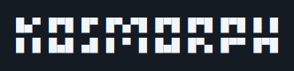

<p align="center">
  
</p>

<h1 align="center">Kosmorph</h1>

<p align="center">
  
  
  
  
  
</p>

**Kosmorph** is a modular, lightweight, cross-platform file management and document utility suite. It brings intelligent folder organization, file operations, document conversion, PDF processing, image utilities, and spreadsheet tools together in one application.

Built around a decoupled Python backend, Kosmorph provides both a Tkinter desktop interface and a command-line interface (CLI). Its smart organization engine incorporates **FOLDR's 31-category sorting architecture**, customizable TOML rules, MIME-type detection and overrides, watch-folder automation, and an ID-based undo journal. 

---

## Table of Contents

- [Overview](#overview)
- [Key Features](#key-features)
- [System Architecture](#system-architecture)
- [Technology Stack](#technology-stack)
- [Project Structure](#project-structure)
- [Installation](#installation)
- [Running the Application](#running-the-application)
- [CLI Quick Reference](#cli-quick-reference)
- [Configuration and External Dependencies](#configuration-and-external-dependencies)
- [Safety and Operation History](#safety-and-operation-history)
- [Plugin Support](#plugin-support)
- [Testing](#testing)
- [Build and Packaging](#build-and-packaging)
- [Acknowledgments](#acknowledgments)
- [Author](#author)
- [License](#license)

---

## Overview

Managing files across multiple directories and working with different document formats can involve repetitive tasks and several disconnected utilities. Kosmorph brings common file management and document-processing workflows into a single application.

The application uses a shared action registry to discover and execute operations. Users can run those actions from the desktop GUI or through the CLI. Its modular design separates core execution and safety infrastructure from individual feature modules, making the codebase easier to maintain and extend.

For file organization, Kosmorph builds on FOLDR's category-based sorting approach and adds configurable rules, MIME-type handling, recursive organization, and folder watching. Supporting utilities cover file operations, document conversion, PDFs, images, and CSV data.

---

## Key Features

### Intelligent File Organization

- Smart sorting across 31 file categories, based on the FOLDR engine.
- Extension-based organization strategies.
- Custom TOML rules for configurable sorting behavior.
- MIME-type detection and override support.
- Recursive organization with configurable scan depth.
- Watch-folder automation for monitored directories.
- Empty-directory cleanup.

### File Management

- Batch file renaming.
- Duplicate file detection.
- File checksum generation.
- ZIP archive operations.
- Empty-directory detection and cleanup.
- Operation history and ID-based undo support.
- Configurable collision handling.

### Document and Data Conversion

- Document and office-format conversion.
- Image format conversion.
- Data-format conversion.
- Optional integration with LibreOffice and Microsoft Office for supported workflows.

### PDF Utilities

- Merge PDF files.
- Split PDF documents.
- Compress PDFs.
- Rotate PDF pages.
- Protect PDF documents.

### Image Processing

- Resize images.
- Compress image files.
- Remove EXIF metadata.

### Spreadsheet Utilities

- Lightweight CSV processing.
- Duplicate-row removal.

### Desktop and CLI

- Tkinter desktop interface.
- Dark and light themes.
- Sidebar navigation and live action search.
- CLI access to registered actions.
- Background task execution and cancellation support.
- External-backend diagnostics.
- Dynamic loading of external plugins.

---

## System Architecture

Kosmorph is organized into modular layers that share a common action and task-execution infrastructure.

1. **Presentation Layer** — The Tkinter GUI provides navigation, action discovery, and interactive access to application features.
2. **CLI Layer** — The command-line interface exposes registered actions for terminal-based workflows and automation.
3. **Core Infrastructure Layer** — Shared task contracts, action registration, background execution, configuration, safety controls, backend detection, and plugin loading.
4. **Feature Modules Layer** — Independent modules handle file organization, conversion, PDF processing, file operations, image utilities, and spreadsheet tasks.
5. **External Backend Layer** — Optional integrations use locally installed applications such as LibreOffice, Microsoft Office, Tesseract, and 7-Zip where supported.

This separation keeps user interaction, task orchestration, and feature-specific processing independent while allowing them to work through shared contracts and services.

---

## Technology Stack

| Component | Technology |
|---|---|
| Programming Language | Python 3.10+ |
| Desktop GUI | Tkinter |
| Task Execution | `concurrent.futures` / `ThreadPoolExecutor` |
| PDF Processing | PyMuPDF |
| Image Processing | Pillow |
| Configuration | JSON preferences and TOML organizer rules |
| Core Dependencies | Pillow, PyMuPDF, PyYAML, Markdown |
| Optional Python Packages | `pdf2docx`, `openpyxl`, `watchdog`, `python-magic` |
| Testing | Pytest |
| Packaging | Setuptools |
| CI/CD | GitHub Actions |

---

## Project Structure

```text
Kosmorph/
│
├── .github/
│   └── workflows/               # Automated build workflows
│
├── assets/
│   └── kosmorph-logo.png        # Project logo used in this README
│
├── kosmorph/
│   ├── __main__.py              # Application entry point
│   │
│   ├── core/                    # Shared application infrastructure
│   │   ├── contracts.py         # TaskContext, TaskResult, MoveOperation, ConflictPolicy
│   │   ├── registry.py          # Action registration, discovery, and search
│   │   ├── runner.py            # Background execution, cancellation, and job history
│   │   ├── safety.py            # Atomic writes, collision policies, and undo journal
│   │   ├── backends.py          # External dependency detection
│   │   ├── config.py            # Persistent configuration and preferences
│   │   └── plugins.py           # Dynamic external plugin loader
│   │
│   ├── modules/                 # Feature-specific processing modules
│   │   ├── organizer/           # Smart file organization and watch-folder support
│   │   ├── converters/          # Document, office, image, and data conversion
│   │   ├── pdf_tools/            # PDF merge, split, compress, rotate, and protect
│   │   ├── file_ops/             # Renaming, duplicates, checksums, directories, and ZIP
│   │   ├── image_tools/          # Image resizing, compression, and EXIF utilities
│   │   └── spreadsheets/        # CSV utilities
│   │
│   ├── cli/                     # Command-line interface
│   └── ui/                      # Tkinter desktop application
│
├── packaging/                   # Linux packaging files
├── tests/                       # Automated test suite
├── .gitattributes
├── .gitignore
├── LICENSE
├── pyproject.toml               # Package metadata and optional dependencies
├── requirements.txt             # Core Python dependencies
└── README.md
```

---

## Installation

### Prerequisites

- Python **3.10 or newer**.
- `pip` and `venv` (included with standard Python installations).
- Tkinter support for running the desktop interface.
- Optional external applications may be needed for specific conversion or utility workflows.

### 1. Clone the Repository

```bash
git clone https://github.com/Usman-Shah-Rashdi/Kosmorph.git
cd Kosmorph
```

### 2. Create a Virtual Environment

```bash
python -m venv .venv
```

### 3. Activate the Environment

**Windows (PowerShell):**

```powershell
.venv\Scripts\Activate.ps1
```

**Linux / macOS:**

```bash
source .venv/bin/activate
```

### 4. Install the Project

Install the full feature set and development dependencies in editable mode:

```bash
python -m pip install --upgrade pip
pip install -e ".[full,dev]"
```

The project also defines an optional `magic` extra for `python-magic` support. Install it together with the other extras when needed:

```bash
pip install -e ".[full,dev,magic]"
```

---

## Running the Application

### Launch the Desktop GUI

From the repository root:

```bash
python -m kosmorph
```

After installation, either console command can also launch the application:

```bash
kosmos
```

```bash
kosmorph
```

### Run CLI Commands from Source

```bash
python -m kosmorph list
python -m kosmorph organize ./Downloads --dry-run
```

After installation, use the `kosmos` or `kosmorph` command directly.

---

## CLI Quick Reference

| Command | Description |
|---|---|
| `kosmos` | Launch the desktop GUI |
| `kosmos gui` | Launch the desktop GUI |
| `kosmos list` | List registered actions |
| `kosmos search pdf` | Search actions by keyword |
| `kosmos diagnostics` | Check optional external backends |
| `kosmos organize ./Downloads --dry-run` | Preview an organization operation |
| `kosmos organize ./Downloads --strategy extension --smart --dry-run` | Preview smart, extension-based organization |
| `kosmos organize ./Downloads --recursive --depth 2` | Organize files recursively to the specified depth |
| `kosmos watch ./Downloads --recursive` | Start a folder watcher |
| `kosmos watches` | List active folder watchers |
| `kosmos unwatch ./Downloads` | Stop a folder watcher |
| `kosmos history` | View operation history |
| `kosmos undo` | Undo the latest recorded operation |
| `kosmos undo --id <ID>` | Undo a specific operation by ID |
| `kosmos convert report.docx --to pdf` | Convert a document to PDF |
| `kosmos convert data.json --to csv` | Convert JSON data to CSV |

Use `kosmorph` instead of `kosmos` where preferred; both console scripts are defined by the project.

---

## Configuration and External Dependencies

Kosmorph stores application preferences through its configuration system and supports TOML rules for file organization. Organizer rules can be customized to adjust how files are classified and sorted.

Some operations can use external applications installed on the host system. Availability depends on the operating system, installed software, and the operation being performed.

| External Dependency | Used For |
|---|---|
| LibreOffice | Supported document and office-format conversion workflows |
| Microsoft Office | Office document processing on supported Windows environments |
| Tesseract | Optional OCR backend detection/integration where supported |
| 7-Zip | Archive-related workflows where supported |

Run the built-in diagnostics command to check detected backends:

```bash
kosmos diagnostics
```

---

## Safety and Operation History

Kosmorph includes shared safeguards for file operations and background tasks:

- **Dry-run support:** Preview supported organization operations before applying changes.
- **Atomic writes:** Reduce the risk of leaving partially written output files.
- **Collision policies:** Apply configured behavior when destination files already exist.
- **Undo journal:** Track operations with unique IDs so a specific recorded operation can be selected for undo.
- **Operation history:** Review previously recorded operations.
- **Background execution:** Run supported tasks outside the main UI thread.
- **Cancellation support:** Cancel supported background tasks.

Always review a dry-run result before applying large-scale file operations, and keep backups of important data.

---

## Plugin Support

Kosmorph supports dynamic loading of external plugins from the following user-level directory:

```text
~/.kosmos/plugins
```

This provides an extension point for adding custom actions without placing their implementation directly inside the core application modules.

---

## Testing

The project uses **Pytest** for its automated test suite. Install the development dependencies and run:

```bash
pytest
```

For verbose test output:

```bash
pytest -v
```

---

## Build and Packaging

The repository includes packaging configuration and GitHub Actions workflows for supported distribution targets. The existing build workflow targets include:

- Debian packages (`.deb`)
- RPM packages (`.rpm`)
- Arch Linux packaging
- Windows builds

See the [`packaging/`](packaging/) directory and [`.github/workflows/`](.github/workflows/) for the repository's packaging and automation files.

---

## Acknowledgments

Kosmorph's smart organization functionality incorporates work adapted from **[FOLDR](https://github.com/foldrhq/Foldr)**, created by **Qasim Sethar ([MQSethar](https://github.com/MQSethar))**.

The adapted components include category definitions, TOML configuration loading, ignore rules, MIME override detection, empty-directory scanning, and watch-folder functionality. FOLDR's 31-category sorting architecture and rule-based approach have been an important foundation for Kosmorph's organization engine.

- [FOLDR GitHub Repository](https://github.com/foldrhq/Foldr)
- [FOLDR Documentation](https://docs.qasimio.me/docs/foldr)

---

## Author

**Usman Shah Rashdi**

- [GitHub Profile](https://github.com/Usman-Shah-Rashdi)
- [Kosmorph Repository](https://github.com/Usman-Shah-Rashdi/Kosmorph)

---

## License

Kosmorph is licensed under the **MIT License**. See the [`LICENSE`](LICENSE) file for the full license text and third-party attribution notices.
