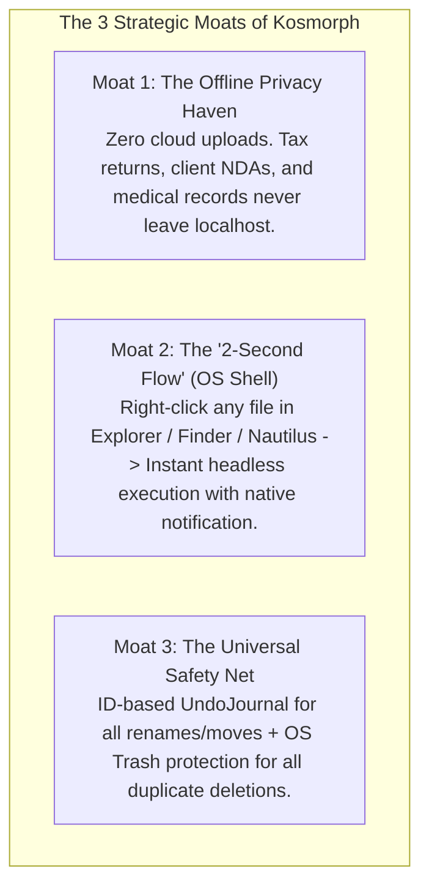
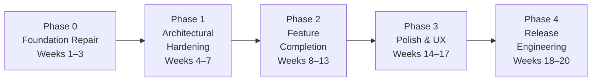

# Kosmorph v1.0 Release Roadmap

> **Document Owner:** Kosmorph Core Team
> **Created:** 2026-11-23
> **Target Release:** Kosmorph v1.0 Stable
> **Current State:** v0.2.0-beta, partially renamed from Kosmos/FOLDR, 20 registered actions, Tkinter GUI + CLI, 1 test file (1 test currently failing)

---

## Vision Statement

**Kosmorph is the single desktop utility that replaces a dozen disjointed file tools.** It organizes folders intelligently, converts documents and media, processes PDFs, deduplicates files, and automates watch-folder workflows — all from one app with a polished GUI, a powerful CLI, and a plugin architecture that lets the community extend it.

The v1.0 release is the moment Kosmorph goes from "interesting project" to "tool I install on every machine." Everything in this roadmap serves that transition: fix what's broken, harden what exists, ship what's promised, and polish what the user sees.

---

## Table of Contents

- [Current State Assessment](#current-state-assessment)
- [Strategic Moats: How Kosmorph Wins](#strategic-moats-how-kosmorph-wins)
- [80/20 Action Prioritization Tiers](#8020-action-prioritization-tiers)
- [Roadmap Overview (Gantt)](#roadmap-overview)
- [Phase 0 — Foundation Repair](#phase-0--foundation-repair-weeks-1-3)
- [Phase 1 — Architectural Hardening](#phase-1--architectural-hardening-weeks-4-7)
- [Phase 2 — Feature Completion](#phase-2--feature-completion-weeks-8-13)
- [Phase 3 — Polish, UX & Shell Integration](#phase-3--polish-ux--shell-integration-weeks-14-17)
- [Phase 4 — Release Engineering](#phase-4--release-engineering-weeks-18-20)
- [Developer Reference Architecture](#developer-reference-architecture-the-universal-action-pattern)
- [10-Sprint Execution Plan](#10-sprint-execution-plan-20-weeks-to-v10)
- [Competitive Landscape & Strategic Differentiation](#competitive-landscape--strategic-differentiation)
- [Plugin Developer SDK](#plugin-developer-sdk-third-party-architecture)
- [Security, Privacy & Data Integrity Manifesto](#security-privacy--data-integrity-manifesto)
- [Post-1.0 Roadmap Signals](#post-10-roadmap-signals)
- [Technical Standards](#technical-standards)
- [Risk Register](#risk-register)
- [Appendix: File-Level Change Map](#appendix-file-level-change-map)

---

## Strategic Moats: How Kosmorph Wins

In 2026, building "just another wrapper around Pillow and PyMuPDF" is not enough to stand out. Users already have single-purpose CLIs (`ffmpeg`, `imagemagick`, `pandoc`) and online web converters (`iLovePDF`, `CloudConvert`).

To become the tool users install on every fresh machine, Kosmorph establishes **three strategic moats**:



1. **Moat 1: The Offline Privacy Haven (Private CloudConvert Alternative)**
   - *The Reality:* Users upload confidential financial spreadsheets, scanned passports, and proprietary code to random conversion websites because desktop tools are too fragmented or complex.
   - *Kosmorph's Hook:* **100% offline, zero telemetry, zero cloud dependencies.** Fast, local, and private.
2. **Moat 2: The "2-Second Flow" (OS Shell Integration)**
   - *The Reality:* If processing a file requires opening an app, waiting for GUI load, navigating file trees, and selecting output folders, users fall back to Google.
   - *Kosmorph's Hook:* **Direct OS context-menu shortcuts.** Right-click `document.pdf` $\rightarrow$ `Kosmorph: Compress PDF` $\rightarrow$ done in 400ms with a native toast notification.
3. **Moat 3: Universal Undo & The Safety Net**
   - *The Reality:* Mass organizing and batch renaming intimidate users due to fear of destructive mistakes.
   - *Kosmorph's Hook:* **Non-sequential git-style rollback.** Every organization and rename records to `UndoJournal`. Deleting duplicates moves to the native OS Trash bin. Zero fear of data loss.

---

## 80/20 Action Prioritization Tiers

To avoid the **"Breadth Trap"** (shipping 87 mediocre actions instead of 20 bulletproof ones), the engineering team will strictly adhere to a 3-tier hierarchy:

### Tier 1: The Core Moat (Sprint 1–6) — 80% of Daily User Workflows
Must have 100% test coverage, comprehensive error handling, and zero UI quirks:
1. **Smart Folder Organization**: 31 categories, EXIF date sorting for photos, `.kosmorphignore`, undo rollback.
2. **PDF Heavyweights**: Merge, split, compress, decrypt/remove password, text watermark, high-DPI image export.
3. **Daily Image Helpers**: Apple HEIC $\rightarrow$ JPG/PNG, WebP convert, resize with Lanczos, safe EXIF/GPS strip.
4. **Excel & Data**: CSV $\leftrightarrow$ XLSX bidirectional conversion, duplicate row cleanup, CSV merge.
5. **File Safety**: Batch rename with template tokens and undo, duplicate finder with OS Trash, empty directory removal.
6. **The 2-Second Flow**: Windows Explorer / macOS Finder / Linux Nautilus right-click context menu shortcuts.

### Tier 2: Power-User Depth (Sprint 7–9)
For technical users, automated scripts, and system administrators:
1. **Text & Encodings**: UTF-8/Latin-1/Shift-JIS convert, CRLF $\leftrightarrow$ LF normalization, BOM strip, batch regex find & replace.
2. **Archive Toolkit**: Multi-format archive extraction (ZIP, 7z, tar, rar), file chunk splitting and re-joining.
3. **OCR Engine**: Tesseract integration for scanned PDFs and images.
4. **Local Security**: AES-256 local file encryption/decryption, DoD 3-pass file shredding, SHA-256 checksum verification.
5. **GUI Dynamic Workbench**: Parameter sliders/spinners, Treeview results table, drag-and-drop file dock.

### Tier 3: Long-Tail & Deferrals (Post-1.0 or Plugin Territory)
Explicitly trimmed from v1.0 core to keep binary size under 35MB and avoid rabbit holes:
- **Deferred to Plugins**: Complex multi-track video transcoding, audio pitch/tempo manipulation, QR code stylized art, photo collage generators.
- **Banned from v1.0**: Heavy local AI/ML models (e.g. PyTorch/ONNX image upscalers) that bloat download sizes to 2GB+.

---

---

## Current State Assessment

### What Works Well
| Area | Strength |
|------|----------|
| Action Architecture | Clean `ActionRegistry` → `ActionSpec` → `TaskContext` → `TaskResult` pipeline; every backend operation is a decorated function |
| Safety Primitives | `atomic_output` context manager prevents partial writes; `UndoJournal` supports non-sequential ID-based rollback |
| Classification Engine | 31-category FOLDR taxonomy with MIME/magic-header fallback, recursive scanning, ignore-file support |
| GUI | Functional 5-view Tkinter desktop app with dark/light theme, threaded job execution, cancel support |
| CLI | Gradient ASCII banner, organize/convert/watch/undo subcommands |
| Cross-Platform | Windows COM automation for Office, Linux daemon spawning, macOS dark-mode detection |

### What's Broken or Missing

| Severity | Issue | Location |
|----------|-------|----------|
| 🔴 Critical | Test suite fails — `UndoJournal()` hardcodes `~/.kosmos` path, crashes in sandboxed/CI environments | `safety.py:56-58`, `engine.py:249` |
| 🔴 Critical | Release CI references build scripts that don't exist (`build-windows.ps1`, `build-packages.sh`) | `.github/workflows/release.yml` |
| 🔴 Critical | Brand schizophrenia — "Kosmorph" in README/logo, "Kosmos" in `pyproject.toml`, CLI `prog`, `.desktop`, PKGBUILD, config dirs | 12+ files |
| 🟠 High | 15 of 20 registered actions unreachable from CLI (PDF tools, image tools, batch rename, duplicates, checksums, ZIP, CSV dedup) | `cli/commands.py` |
| 🟠 High | Image EXIF stripping via `list(img.getdata())` causes multi-GB RAM spike on large images | `image_tools/editor.py:42` |
| 🟠 High | Duplicate deletion permanently unlinks files — no Trash, no undo journal, contradicts safety philosophy | `file_ops/analyzer.py` |
| 🟠 High | Plugin loader has zero error handling — a single bad `.py` file crashes the entire app on startup | `core/plugins.py` |
| 🟡 Medium | `TaskRunner._counter` and `._history` have no thread lock; `_history` grows unbounded (memory leak) | `core/runner.py` |
| 🟡 Medium | `openpyxl` declared as optional dependency but never imported anywhere | `pyproject.toml` |
| 🟡 Medium | Tesseract and 7zip probed in diagnostics but no actions use them | `core/backends.py` |
| 🟡 Medium | `analyzer.py` filename is misleading — file contains only duplicate detection, no analysis | `file_ops/analyzer.py` |
| 🟡 Medium | No logging framework — debug info goes to `print()` or is silently swallowed | Codebase-wide |
| 🟢 Low | `__pycache__` directories committed (and shipped in ZIP) | `.gitignore` incomplete |
| 🟢 Low | No type checking, no linter config, no pre-commit hooks | Project root |

---

## Roadmap Overview



> [!IMPORTANT]
> Phase 0 must be completed before any feature work begins. Every subsequent phase depends on the green test suite and correct brand identity established here.

---

## Phase 0 — Foundation Repair (Weeks 1–3)

**Goal:** Green CI, consistent identity, zero broken infrastructure. No features — only fixes.

### 0.1 Complete the Rebrand: Kosmos → Kosmorph

Every user-visible and machine-readable reference to "Kosmos", "kosmos", "FOLDR", or "PyUtilSuite" must be updated.

| File | Change |
|------|--------|
| `pyproject.toml` | `name = "kosmorph"`, update `[project.scripts]` to single entry `kosmorph = "kosmorph.__main__:main"` (drop `kosmos` alias) |
| `kosmorph/__init__.py` | `__app_name__ = "Kosmorph"` |
| `kosmorph/cli/commands.py` | `prog="kosmorph"`, update `BANNER` text, all help strings |
| `kosmorph/core/safety.py` | Temp file prefix: `.kosmorph_` |
| `kosmorph/core/config.py` | Default dir: `~/.config/kosmorph/` (see §0.2) |
| `kosmorph/modules/organizer/ignore.py` | Add `.kosmorphignore` to `IGNORE_FILENAMES` (keep `.kosmosignore` as legacy fallback), rename `ALWAYS_IGNORE_DIRS` entry from `.kosmos` to `.kosmorph` |
| `kosmorph/modules/organizer/watcher.py` | Update `_WATCHES_FILE` and `_LOG_DIR` paths |
| `packaging/linux/kosmos.desktop` | Rename to `kosmorph.desktop`, update `Name=`, `Exec=`, `Icon=`, `Keywords=` |
| `packaging/arch/PKGBUILD` | `pkgname=kosmorph`, update `url=` to correct GitHub repo |
| `.github/workflows/release.yml` | Update artifact names |

> [!TIP]
> Write a migration function in `config.py` that detects the old `~/.kosmos/` directory and offers to move its contents to the new location on first run. Don't silently break existing users' history and config.

### 0.2 Centralize & Standardize App Directories

Replace every `Path.home() / ".kosmos"` call across the codebase with a single resolver function.

**Implementation:**

```python
# kosmorph/core/paths.py (NEW FILE)
import os
import sys
from pathlib import Path

_APP_NAME = "kosmorph"

def app_data_dir() -> Path:
    """Return the platform-appropriate app data directory.
    
    - Linux/macOS: $XDG_DATA_HOME/kosmorph or ~/.local/share/kosmorph
    - Windows: %LOCALAPPDATA%/kosmorph
    - Override: $KOSMORPH_HOME
    """
    override = os.getenv("KOSMORPH_HOME")
    if override:
        return Path(override)
    if sys.platform == "win32":
        base = Path(os.getenv("LOCALAPPDATA", Path.home() / "AppData" / "Local"))
    else:
        base = Path(os.getenv("XDG_DATA_HOME", Path.home() / ".local" / "share"))
    return base / _APP_NAME

def app_config_dir() -> Path:
    """Return the platform-appropriate config directory."""
    override = os.getenv("KOSMORPH_HOME")
    if override:
        return Path(override)
    if sys.platform == "win32":
        return app_data_dir()
    base = Path(os.getenv("XDG_CONFIG_HOME", Path.home() / ".config"))
    return base / _APP_NAME

def ensure_dir(path: Path) -> Path:
    """Create directory if it doesn't exist and return it."""
    path.mkdir(parents=True, exist_ok=True)
    return path
```

**Consumers to update:**

| Current Hardcoded Path | New Call |
|------------------------|---------|
| `Path.home() / ".kosmos" / "history.json"` | `app_data_dir() / "history.json"` |
| `Path.home() / ".kosmos" / "config.json"` | `app_config_dir() / "config.json"` |
| `Path.home() / ".kosmos" / "plugins"` | `app_data_dir() / "plugins"` |
| `Path.home() / ".kosmos" / "watches.json"` | `app_data_dir() / "watches.json"` |
| `Path.home() / ".kosmos" / "watch_logs"` | `app_data_dir() / "watch_logs"` |
| `Path.home() / ".kosmos" / "categories.toml"` | `app_config_dir() / "categories.toml"` |

**Testing benefit:** Set `KOSMORPH_HOME=/tmp/test-kosmorph` in test fixtures and all state stays in `tmp_path`. No more home directory side effects.

### 0.3 Fix the Test Suite

**Root cause:** `engine.py:249` calls `UndoJournal()` with no arguments → defaults to `~/.kosmos/history.json` → `mkdir` on read-only filesystem → crash.

**Fix strategy:**

1. Add a `conftest.py` with a session-scoped fixture:
   ```python
   # tests/conftest.py
   import os
   import pytest

   @pytest.fixture(autouse=True)
   def isolated_app_home(tmp_path, monkeypatch):
       """Redirect all Kosmorph state to a temp directory."""
       monkeypatch.setenv("KOSMORPH_HOME", str(tmp_path / ".kosmorph"))
   ```

2. After §0.2, `UndoJournal.__init__` reads from `app_data_dir()` which respects `$KOSMORPH_HOME` — tests become fully isolated.

3. Fix the specific test: remove the unused `journal = UndoJournal(journal_path=...)` local variable (it's never used by the action itself).

**Validation:** `pytest` must pass with exit code 0 in the sandbox environment (read-only home).

### 0.4 Set Up CI Pipeline

Create `.github/workflows/ci.yml`:

```yaml
name: CI
on: [push, pull_request]

jobs:
  test:
    strategy:
      matrix:
        os: [ubuntu-latest, windows-latest, macos-latest]
        python: ["3.10", "3.11", "3.12", "3.13"]
    runs-on: ${{ matrix.os }}
    steps:
      - uses: actions/checkout@v4
      - uses: actions/setup-python@v5
        with:
          python-version: ${{ matrix.python }}
      - run: pip install -e ".[dev,full]"
      - run: python -m pytest -v --tb=short
      - run: python -m ruff check kosmorph/ tests/
      - run: python -m mypy kosmorph/core/ --ignore-missing-imports
```

### 0.5 Fix or Remove Broken Release Pipeline

**Option A (recommended):** Replace platform-specific build scripts with standard Python packaging:
```yaml
- run: pip install build
- run: python -m build
```
Ship wheels and sdist to PyPI and attach them to GitHub Releases. Remove references to nonexistent scripts.

**Option B:** Actually create `packaging/build-windows.ps1` and `packaging/linux/build-packages.sh` to produce `.msi`, `.deb`, `.rpm`, and AppImage. This is Phase 4 work.

For Phase 0: take Option A, comment out the platform-specific jobs with a `TODO: Phase 4` note.

### 0.6 Clean Up Repository Hygiene

- Add `__pycache__/` and `*.pyc` to `.gitignore` and purge from history:
  ```bash
  git rm -r --cached '**/__pycache__'
  ```
- Add `pyproject.toml` tooling sections:
  ```toml
  [tool.ruff]
  target-version = "py310"
  line-length = 120

  [tool.mypy]
  python_version = "3.10"
  warn_return_any = true

  [tool.pytest.ini_options]
  testpaths = ["tests"]
  ```
- Add a `.pre-commit-config.yaml` with ruff, mypy, and trailing-whitespace hooks.

### Phase 0 Deliverables Checklist

- [ ] All references say "Kosmorph" / "kosmorph"
- [ ] `kosmorph/core/paths.py` exists and all modules use it
- [ ] `pytest` passes on Linux, macOS, Windows (CI green)
- [ ] `ruff check` and `mypy` pass in CI
- [ ] `__pycache__` purged from repo
- [ ] `.pre-commit-config.yaml` committed
- [ ] Release workflow simplified to Python wheel build
- [ ] Legacy `~/.kosmos` migration logic in `config.py`

---

## Phase 1 — Architectural Hardening (Weeks 4–7)

**Goal:** Make the internals production-grade. Thread safety, proper logging, resilient plugins, testable everything.

### 1.1 Thread Safety & Memory Management in TaskRunner

**File:** `kosmorph/core/runner.py`

| Problem | Fix |
|---------|-----|
| `_counter += 1` without lock | Add `threading.Lock` around counter increment and history append |
| `_history` grows forever | Cap to last 100 entries; add `clear_history()` method |
| `max_workers=2` hardcoded | Accept from `ConfigManager`, default to `min(4, os.cpu_count() or 2)` |
| No `__enter__`/`__exit__` | Add context manager protocol so `TaskRunner` shuts down cleanly |

```python
class TaskRunner:
    def __init__(self, max_workers: int | None = None):
        workers = max_workers or min(4, os.cpu_count() or 2)
        self._executor = ThreadPoolExecutor(max_workers=workers, thread_name_prefix="kosmorph")
        self._history: deque[JobHandle] = deque(maxlen=100)
        self._lock = threading.Lock()
        self._counter = 0

    def __enter__(self): return self
    def __exit__(self, *_): self.shutdown()
```

### 1.2 Structured Logging Framework

Replace all `print()` and silent `except: pass` with Python `logging`.

**Implementation:**

```python
# kosmorph/core/logging.py (NEW FILE)
import logging
import sys

def setup_logging(level: str = "INFO", log_file: str | None = None) -> None:
    fmt = "%(asctime)s [%(levelname)-7s] %(name)s: %(message)s"
    handlers: list[logging.Handler] = [logging.StreamHandler(sys.stderr)]
    if log_file:
        handlers.append(logging.FileHandler(log_file, encoding="utf-8"))
    logging.basicConfig(level=getattr(logging, level.upper()), format=fmt, handlers=handlers)
```

**Adoption plan:**
- Every module file gets `logger = logging.getLogger(__name__)` at module level.
- `except Exception` blocks log the error at `logger.error(...)` or `logger.warning(...)` level.
- CLI gets `--verbose` / `-v` flag mapped to `DEBUG` level.
- GUI log panel subscribes to a custom `logging.Handler` that feeds `self.log_text`.

### 1.3 Resilient Plugin Loader

**File:** `kosmorph/core/plugins.py`

```python
def load_external_plugins(plugin_dir: Path | None = None) -> list[str]:
    if plugin_dir is None:
        plugin_dir = app_data_dir() / "plugins"
    if not plugin_dir.is_dir():
        return []

    loaded: list[str] = []
    for file in sorted(plugin_dir.glob("*.py")):
        if file.name.startswith("_"):
            continue
        try:
            spec = importlib.util.spec_from_file_location(f"kosmorph_plugin_{file.stem}", file)
            if spec and spec.loader:
                module = importlib.util.module_from_spec(spec)
                spec.loader.exec_module(module)
                loaded.append(file.stem)
                logger.info("Loaded plugin: %s", file.stem)
        except Exception:
            logger.exception("Failed to load plugin '%s' — skipping", file.name)
    return loaded
```

**Key change:** `try/except` with `logger.exception()` so a broken plugin file logs a warning and the app continues to start.

### 1.4 Dependency Injection for UndoJournal

Currently `engine.py` and `renamer.py` instantiate `UndoJournal()` inline. This creates untestable, path-coupled code.

**Refactor plan:**

1. Add `undo_journal: UndoJournal | None` field to `TaskContext`:
   ```python
   @dataclass(slots=True)
   class TaskContext:
       on_progress: Optional[Callable[[int, int, str], None]] = None
       is_cancelled: Callable[[], bool] = lambda: False
       conflict_policy: ConflictPolicy = ConflictPolicy.RENAME
       dry_run: bool = False
       undo_journal: Optional["UndoJournal"] = None

       def get_journal(self) -> "UndoJournal":
           if self.undo_journal is None:
               from kosmorph.core.safety import UndoJournal
               self.undo_journal = UndoJournal()
           return self.undo_journal
   ```

2. Update `engine.py:249` and `renamer.py:45`:
   ```python
   # Before:
   op_id = UndoJournal().record(...)
   # After:
   op_id = ctx.get_journal().record(...)
   ```

3. Tests inject a journal backed by `tmp_path` via the fixture.

### 1.5 Fix Critical Module Bugs

#### Image EXIF Stripping Memory Bomb
**File:** `kosmorph/modules/image_tools/editor.py`

```python
# BEFORE (multi-GB RAM spike):
if strip_metadata:
    clean = Image.new(img.mode, img.size)
    clean.putdata(list(img.getdata()))
    img = clean

# AFTER (zero-copy, preserves color profile):
if strip_metadata:
    data = img.tobytes()
    clean = Image.frombytes(img.mode, img.size, data)
    # Preserve ICC profile if present
    icc = img.info.get("icc_profile")
    if icc:
        clean.info["icc_profile"] = icc
    img = clean
```

#### Safe Duplicate Deletion
**File:** `kosmorph/modules/file_ops/analyzer.py` (rename to `duplicates.py`)

```python
# Add send2trash as optional dependency
try:
    from send2trash import send2trash as _trash
    _HAS_TRASH = True
except ImportError:
    _HAS_TRASH = False

# In delete loop:
if delete_duplicates and not ctx.dry_run:
    for p in to_remove:
        try:
            if _HAS_TRASH:
                _trash(str(p))
            else:
                p.unlink()
            deleted_count += 1
        except OSError as exc:
            errors.append(f"{p.name}: {exc}")
```

Add `send2trash` to `pyproject.toml` dependencies (not optional — safety matters).

### 1.6 Expand Test Coverage Target: 70%+

**New test files to create:**

| Test File | Covers |
|-----------|--------|
| `tests/test_registry.py` | Action registration, search, matching, duplicate ID rejection |
| `tests/test_safety.py` | `atomic_output`, `resolve_destination` with all conflict policies, `UndoJournal` CRUD |
| `tests/test_cli.py` | Argument parsing, exit codes, `--version`, error messages |
| `tests/test_converters.py` | Image conversion (PNG→WEBP→JPG round-trip), structured data (JSON↔CSV↔YAML), Markdown→HTML |
| `tests/test_pdf_tools.py` | Merge, split, rotate, compress, encrypt (using small test PDFs generated in fixture) |
| `tests/test_organizer.py` | All 3 strategies (extension/date/size), ignore rules, recursive scan, symlink cycle detection |
| `tests/test_duplicates.py` | Two-pass detection, all keep strategies, delete with trash, empty-dir cleanup |
| `tests/test_plugins.py` | Valid plugin loading, broken plugin resilience, plugin overriding built-in action |
| `tests/test_config.py` | Default values, load/save round-trip, migration from `~/.kosmos` |

**Tooling:**
```toml
# pyproject.toml additions
[tool.pytest.ini_options]
addopts = "--cov=kosmorph --cov-report=term-missing --cov-fail-under=70"
```

### Phase 1 Deliverables Checklist

- [ ] `TaskRunner` is thread-safe with bounded history
- [ ] Structured `logging` throughout — no bare `print()` or silent `except: pass`
- [ ] Plugin loader is crash-resilient
- [ ] `UndoJournal` is injectable through `TaskContext`
- [ ] Image EXIF stripping fixed (memory-safe, color-preserving)
- [ ] Duplicate deletion uses OS Trash by default
- [ ] Test coverage ≥ 70% with 9+ test modules
- [ ] `analyzer.py` renamed to `duplicates.py`

---

## Phase 2 — Feature Completion (Weeks 8–13)

**Goal:** Ship every feature the README promises, expose all actions through CLI, and add the high-value new features that make Kosmorph a "must-install." This is where the app transforms from a beta into a comprehensive utility suite.

### 2.1 Dynamic CLI — Expose All Actions

The current CLI hardcodes a chain of `if/elif` branches and only surfaces ~5 of 20 registered actions. The fix is a **dynamic subcommand generator** driven by the registry.

**Full CLI tree at v1.0:**

```
kosmorph organize <dir> [--strategy ...] [--recursive] [--dry-run]
kosmorph convert <files...> --to <format> [--conflict ...]

kosmorph pdf merge <files...> [--output ...]
kosmorph pdf split <file> [--output-dir ...]
kosmorph pdf rotate <files...> [--angle 90]
kosmorph pdf compress <files...>
kosmorph pdf encrypt <files...> --password <pw>
kosmorph pdf decrypt <files...> --password <pw>
kosmorph pdf watermark <files...> --text "DRAFT" [--opacity 0.3] [--angle 45]
kosmorph pdf pages <files...> [--position bottom-center] [--start 1]
kosmorph pdf extract-images <file> [--output-dir ...]
kosmorph pdf to-images <file> [--format png] [--dpi 300]

kosmorph image convert <files...> --to <format>
kosmorph image optimize <files...> [--max-width ...] [--quality ...] [--strip-exif]
kosmorph image resize <files...> --width W [--height H] [--keep-aspect]
kosmorph image crop <files...> --box "left,top,right,bottom"
kosmorph image watermark <files...> --text "..." [--position ...] [--opacity ...]
kosmorph image to-pdf <files...> [--output ...]
kosmorph image strip-gps <files...>
kosmorph image thumbnails <files...> --size 256

kosmorph files rename <files...> --template "..."
kosmorph files duplicates <dir> [--strategy ...] [--delete]
kosmorph files empty-dirs <dir> [--delete]
kosmorph files checksum <files...> [--algorithm sha256|md5|blake2b]
kosmorph files verify <files...> --hash <expected> [--algorithm ...]
kosmorph files zip <files...> --output <path>
kosmorph files extract <archive> [--output-dir ...]
kosmorph files split <file> --chunk-size 100MB
kosmorph files join <parts...> --output <file>
kosmorph files disk-usage <dir> [--top 20]
kosmorph files touch <files...> [--date "2026-01-15"]
kosmorph files encoding <files...> --to utf-8 [--from latin-1]
kosmorph files line-endings <files...> --to lf|crlf

kosmorph tables dedup <file.csv>
kosmorph tables xlsx-to-csv <files...> [--sheet ...]
kosmorph tables csv-to-xlsx <files...> [--sheet-name ...]
kosmorph tables merge-csv <files...> --output <combined.csv>
kosmorph tables filter <file.csv> --column "name" --contains "..."
kosmorph tables sort <file.csv> --by "column" [--desc]
kosmorph tables stats <file.csv>

kosmorph text md-to-html <files...>
kosmorph text md-to-pdf <files...>
kosmorph text html-to-pdf <files...>
kosmorph text ocr <files...> [--language eng]
kosmorph text extract <files...>

kosmorph watch <dir> [--recursive]
kosmorph unwatch <dir>
kosmorph watches
kosmorph history
kosmorph undo [--id <op_id>] [--dry-run]
kosmorph diagnostics
kosmorph gui
```

**Implementation approach:**
- Group actions by `category` → CLI subparser groups (`pdf`, `files`, `image`, `tables`, `text`).
- Each `ActionSpec` already carries `input_extensions`, `output_formats`, `supports_dry_run` — use these to auto-generate flags.
- Keep the existing `organize`, `convert`, `watch` commands as the top-level shortcuts, but add grouped subcommands for full power.

---

### 2.2 Complete Feature Catalog — New Actions by Module

This is the full inventory of every action Kosmorph v1.0 will ship, organized by module. Items marked 🆕 are new; items marked ✅ already exist.

---

#### 📄 Document & Text Conversions — `kosmorph/modules/converters/`

| Action ID | Name | In → Out | Status | Implementation Notes |
|-----------|------|----------|--------|---------------------|
| `convert.pdf_to_text` | PDF → Text | `.pdf` → `.txt` | ✅ Exists | PyMuPDF text extraction |
| `convert.pdf_to_docx` | PDF → Word | `.pdf` → `.docx` | ✅ Exists | Via `pdf2docx` (optional) |
| `convert.md_to_html` | Markdown → HTML | `.md` → `.html` | ✅ Exists | Python `markdown` library |
| `convert.md_to_pdf` | Markdown → PDF | `.md` → `.pdf` | 🆕 New | Render MD → HTML → PDF via PyMuPDF's `story` or `weasyprint` |
| `convert.html_to_pdf` | HTML → PDF | `.html` → `.pdf` | 🆕 New | Via PyMuPDF Story API or `weasyprint` (optional dep) |
| `convert.txt_to_pdf` | Plain Text → PDF | `.txt` → `.pdf` | 🆕 New | Render monospace text into PDF pages via PyMuPDF |
| `convert.epub_to_pdf` | EPUB → PDF | `.epub` → `.pdf` | 🆕 New | Extract EPUB HTML chapters, render to PDF |
| `convert.epub_to_txt` | EPUB → Text | `.epub` → `.txt` | 🆕 New | Extract chapter text from EPUB XML |
| `convert.office_to_pdf` | Office → PDF | `.docx/.pptx/.xlsx` → `.pdf` | ✅ Exists | LibreOffice or MS Office COM |
| `convert.pdf_ocr` | OCR Scanned PDF | `.pdf` → `.txt`/`.pdf` | 🆕 New | Tesseract + `pytesseract`. Optional dep: `ocr = ["pytesseract>=0.3.10"]` |
| `convert.ocr_image` | OCR Image to Text | `.png/.jpg` → `.txt` | 🆕 New | Direct image OCR via Tesseract |

**New file:** `kosmorph/modules/converters/ocr.py`
**New file:** `kosmorph/modules/converters/text_render.py` (for txt/md/html → PDF)

---

#### 🖼️ Image Conversions & Processing — `kosmorph/modules/converters/images.py` + `kosmorph/modules/image_tools/`

| Action ID | Name | Description | Status | Notes |
|-----------|------|-------------|--------|-------|
| `convert.image` | Format Converter | PNG ↔ JPG ↔ WEBP ↔ BMP ↔ TIFF ↔ GIF ↔ ICO | ✅ Exists | Pillow |
| `convert.images_to_pdf` | Images → PDF | Compile images into multi-page PDF | ✅ Exists | Pillow |
| `convert.heic_to_jpg` | HEIC → JPG/PNG | Convert Apple HEIC/HEIF photos | 🆕 New | Via `pillow-heif` (optional dep). Very high demand — every iPhone user needs this |
| `convert.svg_to_png` | SVG → Raster | Rasterize vector SVGs to PNG/JPG | 🆕 New | Via `cairosvg` (optional dep) or Pillow if simple |
| `convert.pdf_to_images` | PDF → Images | Export each PDF page as a separate image | 🆕 New | PyMuPDF `page.get_pixmap()` with configurable DPI |
| `convert.pdf_extract_images` | Extract Embedded Images | Pull embedded images out of PDF files | 🆕 New | PyMuPDF `page.get_images()` + `extract_image()` |
| `image.optimize` | Resize & Compress | Batch resize, compress, strip EXIF | ✅ Exists | Fix memory bug (Phase 1) |
| `image.resize` | Exact Resize | Resize to exact dimensions or by percentage | 🆕 New | Pillow with Lanczos resampling |
| `image.crop` | Crop Image | Crop to specified box or auto-detect content bounds | 🆕 New | Pillow `img.crop()` |
| `image.rotate` | Rotate Image | Rotate by arbitrary angle with fill | 🆕 New | Pillow `img.rotate()` |
| `image.watermark` | Image Watermark | Overlay text or image watermark on photos | 🆕 New | Pillow `ImageDraw` with transparency |
| `image.strip_gps` | Remove GPS Data | Strip GPS/location EXIF tags only (keep camera info) | 🆕 New | Pillow EXIF manipulation — privacy feature |
| `image.thumbnails` | Generate Thumbnails | Create thumbnail gallery from a folder of images | 🆕 New | Pillow `img.thumbnail()` |
| `image.collage` | Photo Collage | Combine multiple images into a grid layout | 🆕 New | Pillow paste + grid calculation |
| `image.to_grayscale` | Convert to Grayscale | Batch convert color images to grayscale | 🆕 New | Pillow `img.convert("L")` |
| `image.upscale` | Basic Upscale | Upscale small images using Lanczos interpolation | 🆕 New | Pillow resize with quality warning |

**New file:** `kosmorph/modules/image_tools/transform.py` (resize, crop, rotate, grayscale)
**New file:** `kosmorph/modules/image_tools/watermark.py` (text & image watermarks)
**New file:** `kosmorph/modules/image_tools/privacy.py` (GPS stripping, full EXIF management)
**New optional dep:** `heic = ["pillow-heif>=0.16.0"]`, `svg = ["cairosvg>=2.7.0"]`

---

#### 📑 PDF Tools — `kosmorph/modules/pdf_tools/`

| Action ID | Name | Description | Status | Notes |
|-----------|------|-------------|--------|-------|
| `pdf.merge` | Merge PDFs | Combine multiple PDFs into one | ✅ Exists | PyMuPDF |
| `pdf.split` | Split into Pages | Split PDF into individual page files | ✅ Exists | PyMuPDF |
| `pdf.rotate` | Rotate Pages | Rotate all pages by 90/180/270° | ✅ Exists | PyMuPDF |
| `pdf.compress` | Compress PDF | Reduce file size via deflation | ✅ Exists | PyMuPDF |
| `pdf.encrypt` | Encrypt PDF | AES-256 password protection | ✅ Exists | PyMuPDF |
| `pdf.decrypt` | Decrypt PDF | Remove password protection (requires password) | 🆕 New | PyMuPDF `doc.authenticate()` then save without encryption |
| `pdf.watermark` | Text Watermark | Overlay diagonal text on every page | 🆕 New | PyMuPDF text insertion with transparency |
| `pdf.image_watermark` | Image Watermark | Overlay a logo/image on every page | 🆕 New | PyMuPDF `page.insert_image()` |
| `pdf.page_numbers` | Add Page Numbers | Stamp "Page X of Y" on each page | 🆕 New | PyMuPDF text insertion |
| `pdf.extract_pages` | Extract Page Range | Extract pages 5-10 into a new PDF | 🆕 New | PyMuPDF `insert_pdf(from_page, to_page)` |
| `pdf.reorder` | Reorder Pages | Rearrange pages in custom order | 🆕 New | PyMuPDF `doc.move_page()` |
| `pdf.to_images` | PDF to Images | Export pages as PNG/JPG at configurable DPI | 🆕 New | PyMuPDF `get_pixmap(dpi=...)` |
| `pdf.extract_images` | Extract Embedded Images | Pull all embedded images from PDF | 🆕 New | PyMuPDF image extraction API |
| `pdf.metadata` | View/Edit Metadata | Read or set PDF title, author, subject, keywords | 🆕 New | PyMuPDF `doc.metadata` / `set_metadata()` |
| `pdf.redact` | Redact Text | Black out sensitive text regions | 🆕 New | PyMuPDF `page.add_redact_annot()` + `apply_redactions()` |
| `pdf.sign` | Add Signature Image | Place a signature image at a specified position | 🆕 New | PyMuPDF `page.insert_image()` with position args |

**New file:** `kosmorph/modules/pdf_tools/stamp.py` (watermark, page numbers, signature)
**New file:** `kosmorph/modules/pdf_tools/extract.py` (extract pages, extract images, to images)
**New file:** `kosmorph/modules/pdf_tools/metadata.py` (metadata read/write, redaction)

---

#### 📂 File Operations — `kosmorph/modules/file_ops/`

| Action ID | Name | Description | Status | Notes |
|-----------|------|-------------|--------|-------|
| `files.batch_rename` | Batch Rename | Template-based renaming with undo | ✅ Exists | |
| `files.find_duplicates` | Find Duplicates | Two-pass SHA-256 duplicate detection | ✅ Exists | Move to `duplicates.py`, add Trash support |
| `files.clean_empty_dirs` | Clean Empty Dirs | Remove recursively-empty folders | ✅ Exists | |
| `files.checksum` | Checksums | Compute SHA-256 / MD5 / BLAKE2b | ✅ Exists | Add BLAKE2b option |
| `files.verify_checksum` | Verify Checksum | Verify file integrity against a known hash | 🆕 New | Compare computed hash to expected value — essential for downloads |
| `files.create_zip` | Create ZIP | Compress files into ZIP | ✅ Exists | |
| `files.extract_archive` | Extract Archive | Extract ZIP, 7z, tar.gz, rar archives | 🆕 New | Python `zipfile`/`tarfile` native + `7z` subprocess for 7z/rar |
| `files.split` | Split Large File | Split a large file into N-MB chunks | 🆕 New | Binary chunked read/write. Useful for email attachment limits |
| `files.join` | Join Split Files | Reassemble chunked parts into original file | 🆕 New | Binary concatenation with checksum verification |
| `files.disk_usage` | Disk Usage Analyzer | Report directory size breakdown by folder and file type | 🆕 New | Recursive `os.scandir()` with size accumulation |
| `files.touch` | Modify Timestamps | Change file created/modified dates | 🆕 New | `os.utime()` — useful for photo libraries |
| `files.flatten` | Flatten Directory | Move all files from subdirectories into the root folder | 🆕 New | Recursive walk + move to root with conflict policy. Undo-supported |
| `files.tree` | Directory Tree | Generate a directory tree listing (like `tree` command) | 🆕 New | Output as text or JSON. Great for documentation |
| `files.permissions` | Bulk Permissions | Change file permissions recursively (Linux/macOS) | 🆕 New | `os.chmod()` — skipped on Windows |

**New file:** `kosmorph/modules/file_ops/splitter.py` (split/join)
**New file:** `kosmorph/modules/file_ops/disk_usage.py` (directory analysis)
**New file:** `kosmorph/modules/file_ops/filesystem.py` (touch, flatten, tree, permissions)

---

#### 📊 Spreadsheet & Data Tools — `kosmorph/modules/spreadsheets/`

| Action ID | Name | Description | Status | Notes |
|-----------|------|-------------|--------|-------|
| `tables.deduplicate_csv` | Dedup CSV Rows | Remove duplicate rows | ✅ Exists | |
| `convert.xlsx_to_csv` | Excel → CSV | Export Excel worksheets to CSV | 🆕 New | `openpyxl` (already declared as dep, never used!) |
| `convert.csv_to_xlsx` | CSV → Excel | Convert CSV into formatted XLSX workbook | 🆕 New | `openpyxl` with auto-column-width |
| `tables.merge_csv` | Merge CSV Files | Combine multiple CSVs with matching headers | 🆕 New | Standard `csv` module. Handle column mismatches gracefully |
| `tables.filter` | Filter CSV Rows | Filter rows by column value contains/equals/regex | 🆕 New | Standard `csv` + `re` |
| `tables.sort` | Sort CSV | Sort by one or more columns (asc/desc) | 🆕 New | Standard `csv` with `sorted()` |
| `tables.stats` | CSV Quick Stats | Row count, column types, min/max/mean for numeric cols | 🆕 New | Pure Python — no pandas needed |
| `tables.transpose` | Transpose CSV | Swap rows and columns | 🆕 New | Standard `csv` with `zip(*rows)` |
| `tables.json_to_csv` | JSON → CSV | Flatten JSON arrays to CSV (already in structured converter) | ✅ Exists | Part of `convert.structured` |
| `tables.csv_to_json` | CSV → JSON | Convert CSV to JSON array of objects | ✅ Exists | Part of `convert.structured` |

**New file:** `kosmorph/modules/spreadsheets/excel.py` (xlsx ↔ csv)
**New file:** `kosmorph/modules/spreadsheets/operations.py` (merge, filter, sort, stats, transpose)

---

#### 📝 Text & Encoding Utilities — `kosmorph/modules/text_tools/` (NEW MODULE)

| Action ID | Name | Description | Status | Notes |
|-----------|------|-------------|--------|-------|
| `text.convert_encoding` | Change File Encoding | Convert text files between encodings (UTF-8, Latin-1, Shift-JIS, etc.) | 🆕 New | `codecs` module. Auto-detect source via `chardet` (optional dep) |
| `text.line_endings` | Convert Line Endings | CRLF ↔ LF ↔ CR normalization | 🆕 New | Binary read/replace — essential for cross-platform dev |
| `text.strip_bom` | Remove BOM | Strip UTF-8 BOM from text files | 🆕 New | Remove leading `\xef\xbb\xbf` bytes |
| `text.word_count` | Word/Line/Char Count | Count words, lines, characters, paragraphs | 🆕 New | Pure Python — `wc` replacement |
| `text.find_replace` | Batch Find & Replace | Regex-aware find/replace across multiple files | 🆕 New | `re.sub()` with preview (dry-run) mode |
| `text.diff` | File Comparison | Show diff between two text files | 🆕 New | Python `difflib` with unified diff output |
| `text.base64_encode` | Base64 Encode | Encode binary files to Base64 text | 🆕 New | `base64` module |
| `text.base64_decode` | Base64 Decode | Decode Base64 text back to binary | 🆕 New | `base64` module |

**New module directory:** `kosmorph/modules/text_tools/`
**New files:** `encoding.py`, `content.py`, `transform.py`
**New optional dep:** `encoding = ["chardet>=5.0"]`

---

#### 🗂️ Smart Organizer Enhancements — `kosmorph/modules/organizer/`

| Feature | Description | Status | Notes |
|---------|-------------|--------|-------|
| Extension-based sort (31 categories) | Current core engine | ✅ Exists | |
| Date-based sort (Year/Month) | Sort by modification date | ✅ Exists | |
| Size-based sort | Small/Medium/Large/Huge buckets | ✅ Exists | |
| **EXIF date sort** | Organize photos by EXIF capture date, not filesystem mtime | 🆕 New | Pillow EXIF extraction — camera date is the "true" date for photos |
| **Content-type sort** | Use MIME detection as primary classifier (not extension) | ✅ Partial | `--smart` flag exists but could be default |
| **Custom rule presets** | Ship pre-built TOML configs: "Developer", "Photographer", "Student", "Office Worker" | 🆕 New | Store in `kosmorph/presets/` as bundled TOML templates |
| **Flatten + organize** | Recursively flatten subdirectories, then organize flat pool | 🆕 New | Compose `files.flatten` → `organizer.sort` as a pipeline |
| **.kosmorphignore improvements** | Support `!` negation patterns, `#` comments, `**/` globstar | 🆕 New | Bring ignore syntax closer to `.gitignore` |
| **Organization report** | After organizing, produce an HTML/text summary report | 🆕 New | "Moved 142 files into 12 categories — [view report]" |
| **Watch folder improvements** | Cooldown timer, duplicate detection before move, notification on organize | 🆕 New | Prevents re-organizing partially-downloaded files |

**New file:** `kosmorph/modules/organizer/presets.py` (bundled config presets)
**New file:** `kosmorph/modules/organizer/report.py` (organization summary reports)
**New directory:** `kosmorph/presets/` (shipped TOML templates)

---

### 2.3 New Module: Media Tools (Audio & Video) — `kosmorph/modules/media_tools/` (NEW MODULE)

> [!NOTE]
> These features depend on `ffmpeg` as an external backend (similar to how office conversion depends on LibreOffice). Add `ffmpeg` to `backends.py` probe list.

| Action ID | Name | Description | Status | Notes |
|-----------|------|-------------|--------|-------|
| `media.video_to_gif` | Video → GIF | Convert video clip to animated GIF | 🆕 New | `ffmpeg` subprocess |
| `media.extract_audio` | Extract Audio Track | Rip audio from video files | 🆕 New | `ffmpeg -vn` |
| `media.convert_audio` | Audio Format Convert | MP3 ↔ WAV ↔ FLAC ↔ OGG ↔ AAC | 🆕 New | `ffmpeg` subprocess |
| `media.convert_video` | Video Format Convert | MP4 ↔ MKV ↔ AVI ↔ WEBM | 🆕 New | `ffmpeg` subprocess |
| `media.video_thumbnail` | Extract Video Thumbnail | Capture frame at timestamp as image | 🆕 New | `ffmpeg -ss` |
| `media.trim` | Trim Media | Cut audio/video to start-end timestamps | 🆕 New | `ffmpeg -ss -to` |
| `media.compress_video` | Compress Video | Re-encode at lower bitrate/resolution | 🆕 New | `ffmpeg` with CRF control |
| `media.strip_audio_metadata` | Strip Audio Tags | Remove ID3/Vorbis metadata tags | 🆕 New | `ffmpeg -map_metadata -1` |

**New module directory:** `kosmorph/modules/media_tools/`
**New files:** `video.py`, `audio.py`
**Backend probe addition:** `ffmpeg` and `ffprobe` in `backends.py`

---

### 2.4 New Module: Security & Privacy — `kosmorph/modules/security/` (NEW MODULE)

| Action ID | Name | Description | Status | Notes |
|-----------|------|-------------|--------|-------|
| `security.encrypt_file` | Encrypt File | AES-256 file encryption with password | 🆕 New | Via `cryptography` library (optional dep) |
| `security.decrypt_file` | Decrypt File | Decrypt AES-256 encrypted file | 🆕 New | Via `cryptography` library |
| `security.secure_delete` | Secure Delete | Overwrite file contents before deletion (DoD 3-pass) | 🆕 New | Write random bytes → zeros → random bytes → unlink |
| `security.hash_verify` | Verify File Hash | Compare file against known SHA-256/MD5 (from checksum file) | 🆕 New | Parse `.sha256`/`.md5` files and verify |
| `security.strip_metadata` | Strip All Metadata | Remove EXIF, XMP, IPTC from images; metadata from PDFs, Office docs | 🆕 New | Pillow + PyMuPDF metadata clearing |
| `security.qr_generate` | Generate QR Code | Create QR code image from text/URL | 🆕 New | Via `qrcode` library (optional dep) |

**New module directory:** `kosmorph/modules/security/`
**New files:** `encryption.py`, `privacy.py`, `qr.py`
**New optional deps:** `crypto = ["cryptography>=42.0"]`, `qr = ["qrcode>=7.4", "Pillow"]`

---

### 2.5 Batch Processing & Queue System

Currently, the GUI processes one action at a time. Add a **batch queue**:

- Users can queue multiple actions (e.g., "Convert these PDFs to text, then merge them, then encrypt the merged file").
- `TaskRunner` processes the queue sequentially or in parallel (configurable).
- Each item shows status in a queue panel: Pending → Running → Complete / Failed.

**Data model:**
```python
@dataclass
class BatchItem:
    action_id: str
    kwargs: dict[str, Any]
    depends_on: list[str]  # job_ids this item waits for
    status: Literal["pending", "running", "done", "failed"]
```

### 2.6 Action Chaining / Pipelines

Allow users to define **pipelines** — sequences of actions where each step's output feeds the next:

```bash
# CLI example: convert all PNGs to JPG, then optimize, then create ZIP
kosmorph chain \
  "convert.image --to jpg" \
  "image.optimize --quality 80 --strip-exif" \
  "files.create_zip --output photos.zip" \
  -- photos/*.png
```

**GUI:** A "Pipeline Builder" view where you drag actions into a sequence, configure each step, and run the whole chain.

### 2.7 Drag-and-Drop Support

**Tkinter limitation:** Native tkinter supports basic drag-and-drop, but for file drops from the OS file manager, use `tkinterdnd2`.

**Implementation:**
- Add `tkinterdnd2` as optional GUI dependency.
- Register drop targets on the organizer folder entry, file selection entry, and cleanup folder entry.
- When files are dropped, populate the corresponding `StringVar` and trigger the auto-match.

### 2.8 Localization Groundwork (i18n)

Prepare for future translations:
- Extract all user-facing strings into a `kosmorph/i18n/en.py` constants module.
- Use a simple `_("string key")` pattern that can later be backed by `gettext` or a custom loader.
- For v1.0: English only, but the architecture is in place.

---

### 2.9 Complete v1.0 Action Count Summary

| Module | Existing | New | v1.0 Total |
|--------|----------|-----|------------|
| Converters (Documents/Text) | 5 | 6 | **11** |
| Image Conversions & Tools | 3 | 13 | **16** |
| PDF Tools | 6 | 10 | **16** |
| File Operations | 5 | 8 | **13** |
| Spreadsheets & Data | 2 (+ structured) | 8 | **10** |
| Text & Encoding | 0 | 8 | **8** |
| Smart Organizer | 1 | 4 enhancements | **1** (enhanced) |
| Media Tools (Audio/Video) | 0 | 8 | **8** |
| Security & Privacy | 0 | 6 | **6** |
| **TOTAL** | **~20** | **~67** | **~87 actions** |

> [!IMPORTANT]
> Not every new action needs to ship in v1.0.0 exactly. Prioritize by user demand:
> - **Must-have for 1.0:** HEIC conversion, PDF decrypt/watermark/extract, archive extraction, Excel support, encoding tools, image resize/crop, text find-replace, disk usage
> - **High value:** OCR, media conversions, QR codes, file encryption
> - **Nice-to-have:** Collage, transpose, secure delete, pipeline builder

### 2.10 New Optional Dependencies Summary

```toml
# pyproject.toml — updated [project.optional-dependencies]
[project.optional-dependencies]
docx = ["pdf2docx>=0.5.8"]
xlsx = ["openpyxl>=3.1.0"]
watch = ["watchdog>=4.0.0"]
magic = ["python-magic>=0.4.27"]
ocr = ["pytesseract>=0.3.10"]
heic = ["pillow-heif>=0.16.0"]
svg = ["cairosvg>=2.7.0"]
crypto = ["cryptography>=42.0"]
qr = ["qrcode>=7.4"]
encoding = ["chardet>=5.0"]
html2pdf = ["weasyprint>=62.0"]
dev = ["pytest>=8.0.0", "pytest-cov>=5.0", "ruff>=0.8", "mypy>=1.12"]
full = [
    "pdf2docx>=0.5.8", "openpyxl>=3.1.0", "watchdog>=4.0.0",
    "pytesseract>=0.3.10", "pillow-heif>=0.16.0", "cairosvg>=2.7.0",
    "cryptography>=42.0", "qrcode>=7.4", "chardet>=5.0",
]
```

### Phase 2 Deliverables Checklist

- [ ] CLI exposes all registered actions via grouped subcommands
- [ ] Excel ↔ CSV conversion implemented (`openpyxl`)
- [ ] OCR action implemented (requires Tesseract binary)
- [ ] Archive extraction implemented (ZIP native, 7z/rar via subprocess)
- [ ] HEIC → JPG/PNG conversion
- [ ] SVG → PNG rasterization
- [ ] PDF decrypt, watermark, page numbers, extract images, to images, extract pages, metadata
- [ ] Image resize, crop, rotate, watermark, GPS strip, thumbnails, grayscale
- [ ] File split/join, disk usage analyzer, flatten directory, directory tree
- [ ] Text encoding conversion, line ending normalization, BOM strip, find-replace, diff
- [ ] CSV merge, filter, sort, stats, transpose
- [ ] Media tools: video-to-gif, extract audio, audio/video format conversion (ffmpeg)
- [ ] Security: file encryption/decryption, secure delete, QR generation
- [ ] Organizer: EXIF date sort, bundled presets, organization report
- [ ] Action chaining / pipeline system
- [ ] Drag-and-drop file selection in GUI
- [ ] Batch queue system in GUI
- [ ] i18n string extraction complete

---

## Phase 3 — Polish, UX & Shell Integration (Weeks 14–17)

**Goal:** Transform Kosmorph from a functional Python script suite into an indispensable, premium desktop tool with instant OS integration and zero-friction workflows.

### 3.1 OS Shell Context Menu Integration (The "2-Second Flow")

The biggest killer of utility apps is friction. If a user has to open an application, browse folders, select an action, and choose an output location, they will default to a web converter. 

**The Solution:** Right-click context menu integration across all three major desktop platforms.


#### Platform Implementations:
1. **Windows (Explorer Extension / Registry)**:
   - Installer registers sub-commands under `HKEY_CURRENT_USER\Software\Classes\*\shell\Kosmorph`:
     - `Compress PDF` (filtered to `.pdf`)
     - `Convert to WebP` (filtered to `.png;.jpg;.jpeg`)
     - `Organize Folder` (directory background context menu)
   - Executable runs with `--headless` flag (no Tkinter window spawned).
2. **macOS (Finder Quick Actions / Automator)**:
   - Shipped `.workflow` Quick Actions invoking `kosmorph` CLI with selected files.
   - Native Notification Center toasts via `osascript`.
3. **Linux (Nautilus / Dolphin / Nemo Action Scripts)**:
   - `.desktop` actions placed in `~/.local/share/nautilus/scripts/` or `kio-servicemenus`.
   - Native notifications via `notify-send`.

---

### 3.2 Visual "Before / After" Quality Slider (Images & PDFs)

When compressing media, users are often anxious about visual degradation. "Will 75% quality ruin my presentation photos? Will my scanned PDF text be unreadable?"

**The Solution:** Interactive side-by-side split slider in the GUI Workbench:
- **Left pane:** Original document/image.
- **Right pane:** In-memory compressed preview.
- **Draggable vertical divider:** Users slide across the canvas to inspect fine details (hair, small font, gradients).
- **Live delta metrics:** Displays real-time size comparison (e.g. `Original: 5.2 MB | Compressed: 840 KB | Savings: 83.8%`).

---

### 3.3 Floating Smart Dropzone / HUD Widget

A borderless, compact floating drop widget accessible via hotkey (`Ctrl + Space` or `Cmd + Shift + K`) or from the system tray:
- Stays "Always on Top" when toggled.
- Drag any file or directory onto the dropzone:
  - Drop a camera folder $\rightarrow$ instantly prompts: `[Sort by EXIF Date]` `[Strip GPS]` `[Convert HEIC]`
  - Drop a messy folder $\rightarrow$ instantly prompts: `[Smart Organize]` `[Clean Empty Dirs]` `[Find Duplicates]`
  - Drop a CSV $\rightarrow$ instantly prompts: `[Convert to Excel]` `[Deduplicate Rows]` `[Quick Summary]`
- Executes the task in the background without opening the full desktop application window.

---

### 3.4 GUI Redesign & Workbench Parameter Panels

Replace the brittle generic "Extra Arg" text box with **typed parameter widgets** dynamically generated from `ParamDescriptor`:

| Parameter Type | Auto-Generated GUI Widget | Example Usage |
|---|---|---|
| `ParamType.INTEGER` | `ttk.Spinbox` with min/max clamps | PDF rotation angle, image width, JPEG quality |
| `ParamType.FLOAT` | `ttk.Scale` slider with value label | Watermark opacity (0.0 to 1.0) |
| `ParamType.BOOLEAN` | `ttk.Checkbutton` with label | Strip EXIF, keep aspect ratio, dry run |
| `ParamType.CHOICE` | `ttk.Combobox` (readonly) with options | Deduplication strategy, output formats |
| `ParamType.PASSWORD` | `ttk.Entry` (masked `show="*"`) | PDF encryption password |
| `ParamType.FILE_PATH` | `ttk.Entry` with inline "Browse..." picker | Watermark logo path, reference hash file |

#### Treeview Results & Reporting
- Replace primitive `tk.Listbox` with a sortable, multi-column `ttk.Treeview`:
  - Columns: `Status Icon` | `File Name` | `Action` | `Result / Destination` | `Size Delta`
  - Right-click row context menu: "Reveal in File Manager", "Copy Path", "Undo This Move".
  - One-click "Export Execution Log to JSON/CSV".

---

### 3.5 System Tray & Background Watcher Daemon Controls

- Persistent system tray icon (`pystray`) for long-running watch-folder automation.
- Left-click: Toggle GUI main window visibility.
- Right-click context menu:
  - `Active Watchers (3)` $\rightarrow$ pause/resume specific folder watches.
  - `Recent Operations` $\rightarrow$ quick list of last 5 organized files with instant "Undo" button.
  - `Preferences...` $\rightarrow$ quick config.
  - `Quit Kosmorph`.

---

### 3.6 Keyboard Shortcuts & Accessibility

| Shortcut | Action | Scope |
|---|---|---|
| `Ctrl + O` | Select folder to organize | Main Window |
| `Ctrl + Shift + O` | Select files for Workbench | Main Window |
| `Ctrl + Z` | Revert / Undo latest operation | Global in App |
| `Ctrl + Shift + Z` | Open History & Rollback View | Global in App |
| `Ctrl + Enter` | Execute currently selected action | Workbench / Organizer |
| `Ctrl + D` | Toggle Dry-Run mode | Workbench / Organizer |
| `Escape` | Cancel active background job | Global in App |
| `Ctrl + Space` | Summon Floating Dropzone HUD | System-wide Hotkey |
| `F1` | Open Documentation | Global in App |

- **High-DPI Awareness:** Automatically detects scaling factors on Windows (`SetProcessDpiAwareness`) and Wayland/macOS Retina displays.
- **Platform-Aware Fonts:** Segoe UI on Windows, SF Pro on macOS, Noto Sans / Ubuntu on Linux.

---

### 3.7 CLI Output Polish

- `--json`: Formats all outputs as structured JSON lines for shell scripting (`kosmorph files duplicates ~/Downloads --json | jq .removable`).
- `--quiet` / `-q`: Completely silences banners, spinners, and progress text for cron and CI usage.
- Standardized UNIX Exit Codes:
  - `0`: Success (all items processed without error).
  - `1`: Partial failure (some files processed, but errors occurred on others).
  - `2`: Complete failure (invalid parameters or unhandled exception).
  - `3`: Action aborted by user cancellation.
- Full color escape support respecting the `NO_COLOR` standard.

---

### 3.8 Documentation Suite

| Document | Target Audience | Key Contents |
|---|---|---|
| `README.md` | Public GitHub / PyPI | Animated demo GIFs, 30-second quickstart, architecture diagram, benchmark numbers |
| `docs/cli-reference.md` | Power users / sysadmins | Every command, argument, flag, environment variable, and exit code |
| `docs/plugin-authoring.md` | Third-party developers | How to write and distribute `@register_action` plugins |
| `docs/shell-integration.md` | Desktop users | Step-by-step setup for right-click context menus on Windows, macOS, and Linux |
| `docs/configuration.md` | Customizers | TOML category templates, ignore file rules, daemon configuration |
| `CONTRIBUTING.md` | Open-source contributors | Dev setup, testing checklist, PR standards |
| `CHANGELOG.md` | Users & packagers | Keep a Changelog standard tracking all additions, fixes, and security patches |

---

### Phase 3 Deliverables Checklist

- [ ] OS right-click context menu extensions (Windows Explorer, macOS Finder, Linux Nautilus)
- [ ] Visual "Before / After" split-view quality slider in GUI for image/PDF compression
- [ ] Floating Smart Dropzone HUD widget with hotkey activation
- [ ] Dynamic parameter panels generated from `ParamDescriptor`
- [ ] Sortable multi-column `Treeview` results table with "Reveal in File Manager"
- [ ] System tray integration (`pystray`) with watcher pause/resume controls
- [ ] Global keyboard shortcuts and High-DPI screen adaptation
- [ ] Scriptable CLI flags (`--json`, `--quiet`, standard exit codes)
- [ ] Complete documentation suite with shell integration guides

---

## Phase 4 — Release Engineering (Weeks 18–20)

**Goal:** Ship installable artifacts for every platform and publish to PyPI.

### 4.1 PyPI Publication

```toml
# pyproject.toml updates
[project.urls]
Homepage = "https://github.com/<org>/kosmorph"
Documentation = "https://kosmorph.dev/docs"
"Bug Tracker" = "https://github.com/<org>/kosmorph/issues"
Changelog = "https://github.com/<org>/kosmorph/blob/main/CHANGELOG.md"
```

- Build and publish to PyPI via `python -m build` + `twine upload`.
- Add `[build-system]` already exists — verify it works with `pip install kosmorph`.
- Test: `pipx install kosmorph` and `kosmorph --version` works.

### 4.2 Platform Packaging

#### Linux
| Format | Tool | Script |
|--------|------|--------|
| `.deb` (Debian/Ubuntu) | `dpkg-deb` | `packaging/linux/build-deb.sh` |
| `.rpm` (Fedora/RHEL) | `rpmbuild` | `packaging/linux/build-rpm.sh` |
| AppImage | `appimagetool` | `packaging/linux/build-appimage.sh` |
| Flatpak | `flatpak-builder` | `packaging/linux/com.kosmorph.Kosmorph.yml` |
| Arch (AUR) | `makepkg` | `packaging/arch/PKGBUILD` (already exists, needs update) |

#### Windows
| Format | Tool | Script |
|--------|------|--------|
| Portable `.zip` | `zipfile` | `packaging/windows/build-portable.ps1` |
| Installer `.msi` | `cx_Freeze` or `WiX` | `packaging/windows/build-msi.ps1` |
| `.exe` (single file) | `PyInstaller` | `packaging/windows/build-exe.ps1` |

#### macOS
| Format | Tool | Script |
|--------|------|--------|
| `.app` bundle | `py2app` | `packaging/macos/build-app.sh` |
| `.dmg` disk image | `create-dmg` | `packaging/macos/build-dmg.sh` |
| Homebrew formula | `brew` | `packaging/macos/kosmorph.rb` |

### 4.3 Release CI/CD Pipeline

Rewrite `.github/workflows/release.yml`:

```yaml
name: Release
on:
  push:
    tags: ["v*"]

jobs:
  pypi:
    runs-on: ubuntu-latest
    steps:
      - uses: actions/checkout@v4
      - run: pip install build twine
      - run: python -m build
      - run: twine upload dist/*
        env:
          TWINE_USERNAME: __token__
          TWINE_PASSWORD: ${{ secrets.PYPI_TOKEN }}

  linux:
    runs-on: ubuntu-latest
    steps:
      # Build .deb, .rpm, AppImage
      - uses: actions/checkout@v4
      - run: packaging/linux/build-packages.sh "${GITHUB_REF_NAME#v}"
      - uses: actions/upload-artifact@v4
        with: { name: linux, path: dist/packages/* }

  windows:
    runs-on: windows-latest
    steps:
      - uses: actions/checkout@v4
      - run: packaging/windows/build-exe.ps1
      - uses: actions/upload-artifact@v4
        with: { name: windows, path: dist/packages/* }

  macos:
    runs-on: macos-latest
    steps:
      - uses: actions/checkout@v4
      - run: packaging/macos/build-dmg.sh
      - uses: actions/upload-artifact@v4
        with: { name: macos, path: dist/packages/* }

  release:
    needs: [pypi, linux, windows, macos]
    runs-on: ubuntu-latest
    steps:
      - uses: actions/download-artifact@v4
        with: { path: dist, merge-multiple: true }
      - uses: softprops/action-gh-release@v2
        with:
          files: dist/*
          generate_release_notes: true
```

### 4.4 Pre-Release Testing

- **Alpha releases** (`v1.0.0a1`) after Phase 2 completion — distributed to team for internal testing.
- **Beta releases** (`v1.0.0b1`) after Phase 3 — distributed to early adopters via PyPI pre-release.
- **Release candidates** (`v1.0.0rc1`) after Phase 4 packaging — full matrix testing on all platforms.
- **Final release** (`v1.0.0`) — tag, build, publish, announce.

### Phase 4 Deliverables Checklist

- [ ] `pip install kosmorph` works from PyPI
- [ ] `pipx install kosmorph` works
- [ ] Linux packages: `.deb`, `.rpm`, AppImage, Arch PKGBUILD
- [ ] Windows: portable `.zip`, `.exe` installer
- [ ] macOS: `.dmg` with `.app` bundle
- [ ] Release CI/CD pipeline builds and publishes all artifacts on tag push
- [ ] CHANGELOG.md updated for v1.0.0
- [ ] GitHub Release with generated release notes + all artifacts

---

## Post-1.0 Roadmap Signals

> [!NOTE]
> v1.0 is the foundation. These are confirmed areas of investment for v1.x and v2.0, shared here so the team can architect v1.0 decisions with forward compatibility in mind.

### v1.1 — Cloud & Sync
- **Cloud storage backends:** Google Drive, Dropbox, OneDrive as source/destination for organize and convert.
- **Sync profiles:** "Organize my Downloads folder on this machine the same way as on my other machine" via exported/imported config.

### v1.2 — Advanced Automation
- **Rule engine:** "When a `.pdf` appears in `~/Downloads`, OCR it and move to `~/Documents/Searchable`."
- **Scheduled jobs:** Cron-like recurring organization (beyond the current watch-folder model).
- **CLI piping:** `kosmorph convert --to csv | kosmorph tables dedup` — stdin/stdout pipeline support.

### v1.3 — AI-Assisted Features
- **Smart categorization:** Use a local ML model (e.g., a small ONNX classifier) to categorize files by content, not just extension.
- **Duplicate detection by similarity:** Detect near-duplicate images (perceptual hashing), documents (text similarity).
- **Natural language CLI:** `kosmorph "merge all PDFs in Downloads and encrypt with password XYZ"`.

### v2.0 — Qt/Web UI Rewrite
- Migrate from Tkinter to **PySide6 (Qt)** or an **Electron/Tauri web frontend** for a modern, fully-customizable UI.
- Plugin marketplace: community-contributed action plugins installable from a registry.
- Multi-language support using the i18n groundwork from v1.0.

---

## Technical Standards

### Code Quality Gates (enforced in CI)

| Check | Tool | Threshold |
|-------|------|-----------|
| Linting | `ruff` | Zero errors, zero warnings |
| Type checking | `mypy` (strict on `core/`) | Zero errors in `kosmorph/core/` |
| Test coverage | `pytest-cov` | ≥ 70% (Phase 1), ≥ 80% (v1.0) |
| Complexity | `ruff` McCabe | No function exceeds C15 |
| Security | `bandit` or `pip-audit` | Zero high/critical findings |
| Docs | `ruff` pydocstyle rules | All public APIs documented |

### Git & Branch Strategy

| Branch | Purpose |
|--------|---------|
| `main` | Always releasable. Protected: requires PR + CI green + 1 approval. |
| `develop` | Integration branch for in-progress phase work. |
| `feature/<name>` | Individual feature branches off `develop`. |
| `fix/<issue-number>` | Bug fix branches. |
| `release/v1.0.0` | Release candidate branch, cut from `develop` when feature-complete. |

### Versioning

Follow [SemVer](https://semver.org/):
- `0.3.0` — After Phase 0 (foundation repair)
- `0.4.0` — After Phase 1 (architectural hardening)
- `0.5.0` — After Phase 2 (feature completion)
- `1.0.0-rc.1` — After Phase 3 (polish)
- `1.0.0` — Final release after Phase 4

### Dependency Policy

| Category | Rule |
|----------|------|
| Core deps | Minimize: Pillow, PyMuPDF, PyYAML, Markdown, `send2trash` — that's it |
| Optional deps | Clearly documented extras: `[docx]`, `[xlsx]`, `[watch]`, `[magic]`, `[ocr]` |
| System binaries | Never fail if missing — degrade gracefully with clear error messages |
| Python version | ≥ 3.10 (for `match` statements, `X | Y` union types, `tomllib`) |

---

## Risk Register

| Risk | Likelihood | Impact | Mitigation |
|------|-----------|--------|------------|
| Tkinter looks dated compared to Electron apps | High | Medium | Invest in polish (Phase 3), plan Qt migration post-1.0 |
| PyMuPDF AGPL license concerns for commercial users | Medium | High | Document licensing clearly; evaluate `pymupdf` Community vs alternatives (`pikepdf`, `pypdf`) |
| `pdf2docx` abandoned / breaking on newer Python | Medium | Medium | Pin version; have fallback error message; evaluate alternatives |
| Team bandwidth — 20-week plan is ambitious | Medium | High | Phases are independent milestones; ship `0.x` releases at each phase boundary |
| Cross-platform COM automation unreliable | High | Low | Already gracefully handled; document as "best-effort" in Office converter |
| Plugin system security (arbitrary code execution) | Low | High | Document risk; v1.1 consider sandboxed plugin loading |

---

## Appendix: File-Level Change Map

> Reference for the team: every file that needs to be created, modified, renamed, or deleted for v1.0.

### New Files to Create

#### Phase 0 — Foundation

| Path | Purpose |
|------|---------|
| `kosmorph/core/paths.py` | Centralized XDG-compliant path resolution |
| `tests/conftest.py` | Shared fixtures, `KOSMORPH_HOME` isolation |
| `.github/workflows/ci.yml` | CI pipeline |
| `.pre-commit-config.yaml` | Pre-commit hooks |
| `CHANGELOG.md` | Change log (start immediately) |

#### Phase 1 — Hardening

| Path | Purpose |
|------|---------|
| `kosmorph/core/log.py` | Structured logging setup |
| `kosmorph/modules/file_ops/duplicates.py` | Moved from `analyzer.py`, with Trash support |
| `tests/test_registry.py` | Registry unit tests |
| `tests/test_safety.py` | Safety module tests |
| `tests/test_cli.py` | CLI tests |
| `tests/test_converters.py` | Converter tests |
| `tests/test_pdf_tools.py` | PDF tool tests |
| `tests/test_organizer.py` | Organizer engine tests |
| `tests/test_duplicates.py` | Duplicate detection tests |
| `tests/test_plugins.py` | Plugin loader tests |
| `tests/test_config.py` | Config manager tests |

#### Phase 2 — New Feature Modules & Actions

| Path | Purpose |
|------|---------|
| **Converters** | |
| `kosmorph/modules/converters/ocr.py` | Tesseract OCR: `convert.pdf_ocr`, `convert.ocr_image` |
| `kosmorph/modules/converters/text_render.py` | `convert.md_to_pdf`, `convert.html_to_pdf`, `convert.txt_to_pdf`, `convert.epub_to_pdf`, `convert.epub_to_txt` |
| **Image Tools** | |
| `kosmorph/modules/image_tools/transform.py` | `image.resize`, `image.crop`, `image.rotate`, `image.to_grayscale`, `image.upscale` |
| `kosmorph/modules/image_tools/watermark.py` | `image.watermark` (text & image overlays) |
| `kosmorph/modules/image_tools/privacy.py` | `image.strip_gps`, `security.strip_metadata` |
| **PDF Tools** | |
| `kosmorph/modules/pdf_tools/stamp.py` | `pdf.watermark`, `pdf.image_watermark`, `pdf.page_numbers`, `pdf.sign` |
| `kosmorph/modules/pdf_tools/extract.py` | `pdf.extract_pages`, `pdf.extract_images`, `pdf.to_images` |
| `kosmorph/modules/pdf_tools/metadata.py` | `pdf.metadata`, `pdf.redact`, `pdf.decrypt`, `pdf.reorder` |
| **File Operations** | |
| `kosmorph/modules/file_ops/disk_usage.py` | `files.disk_usage` directory analyzer |
| `kosmorph/modules/file_ops/splitter.py` | `files.split`, `files.join` |
| `kosmorph/modules/file_ops/filesystem.py` | `files.touch`, `files.flatten`, `files.tree`, `files.permissions` |
| **Spreadsheets** | |
| `kosmorph/modules/spreadsheets/excel.py` | `convert.xlsx_to_csv`, `convert.csv_to_xlsx` via openpyxl |
| `kosmorph/modules/spreadsheets/operations.py` | `tables.merge_csv`, `tables.filter`, `tables.sort`, `tables.stats`, `tables.transpose` |
| **Text & Encoding (NEW MODULE)** | |
| `kosmorph/modules/text_tools/__init__.py` | Module init |
| `kosmorph/modules/text_tools/encoding.py` | `text.convert_encoding`, `text.line_endings`, `text.strip_bom` |
| `kosmorph/modules/text_tools/content.py` | `text.word_count`, `text.diff` |
| `kosmorph/modules/text_tools/transform.py` | `text.find_replace`, `text.base64_encode`, `text.base64_decode` |
| **Media Tools (NEW MODULE)** | |
| `kosmorph/modules/media_tools/__init__.py` | Module init |
| `kosmorph/modules/media_tools/video.py` | `media.video_to_gif`, `media.convert_video`, `media.video_thumbnail`, `media.trim`, `media.compress_video` |
| `kosmorph/modules/media_tools/audio.py` | `media.extract_audio`, `media.convert_audio`, `media.strip_audio_metadata` |
| **Security & Privacy (NEW MODULE)** | |
| `kosmorph/modules/security/__init__.py` | Module init |
| `kosmorph/modules/security/encryption.py` | `security.encrypt_file`, `security.decrypt_file` |
| `kosmorph/modules/security/privacy.py` | `security.secure_delete`, `security.hash_verify`, `security.strip_metadata` |
| `kosmorph/modules/security/qr.py` | `security.qr_generate` |
| **Organizer Enhancements** | |
| `kosmorph/modules/organizer/presets.py` | Bundled TOML config presets (Developer, Photographer, etc.) |
| `kosmorph/modules/organizer/report.py` | Post-organization HTML/text summary report |
| `kosmorph/presets/developer.toml` | Preset: Developer workspace categories |
| `kosmorph/presets/photographer.toml` | Preset: Photography workflow categories |
| `kosmorph/presets/student.toml` | Preset: Student/academic categories |
| `kosmorph/presets/office.toml` | Preset: Office worker categories |
| **i18n** | |
| `kosmorph/i18n/__init__.py` | i18n module init |
| `kosmorph/i18n/en.py` | English string constants |

#### Phase 3 — Documentation

| Path | Purpose |
|------|---------|
| `docs/cli-reference.md` | CLI documentation |
| `docs/plugin-authoring.md` | Plugin development guide |
| `docs/configuration.md` | Configuration guide |
| `CONTRIBUTING.md` | Contributor guide |

#### Phase 4 — Packaging

| Path | Purpose |
|------|---------|
| `packaging/linux/build-packages.sh` | Linux package builder (.deb, .rpm, AppImage) |
| `packaging/linux/build-deb.sh` | Debian package builder |
| `packaging/linux/build-rpm.sh` | RPM package builder |
| `packaging/linux/build-appimage.sh` | AppImage builder |
| `packaging/windows/build-exe.ps1` | Windows PyInstaller executable builder |
| `packaging/windows/build-portable.ps1` | Windows portable ZIP builder |
| `packaging/macos/build-app.sh` | macOS .app bundle builder |
| `packaging/macos/build-dmg.sh` | macOS DMG builder |
| `packaging/macos/kosmorph.rb` | Homebrew formula |

### Files to Modify

| Path | Phase | Change Summary |
|------|-------|---------------|
| `pyproject.toml` | 0, 1, 2 | Rename to kosmorph, add ruff/mypy/pytest config, add new deps |
| `kosmorph/__init__.py` | 0 | Update `__app_name__` |
| `kosmorph/__main__.py` | 0 | No change needed if paths module works |
| `kosmorph/core/safety.py` | 0, 1 | Use `paths.py`, rename temp prefix, injectable journal |
| `kosmorph/core/config.py` | 0 | Use `paths.py`, add migration logic |
| `kosmorph/core/plugins.py` | 0, 1 | Use `paths.py`, add error handling |
| `kosmorph/core/runner.py` | 1 | Thread safety, bounded history, context manager |
| `kosmorph/core/contracts.py` | 1 | Add `undo_journal` to `TaskContext` |
| `kosmorph/core/registry.py` | 2 | Add parameter schema support for dynamic CLI/GUI |
| `kosmorph/core/backends.py` | 2 | Only probe backends that have consuming actions |
| `kosmorph/cli/commands.py` | 0, 2, 3 | Rebrand, dynamic subcommands, `--json`/`--quiet` |
| `kosmorph/ui/app.py` | 2, 3 | Dynamic param panels, treeview results, drag-drop, shortcuts, tray |
| `kosmorph/ui/theme.py` | 3 | Platform-aware fonts, HiDPI |
| `kosmorph/modules/image_tools/editor.py` | 1 | Fix EXIF memory bomb |
| `kosmorph/modules/organizer/engine.py` | 1 | Use injected journal |
| `kosmorph/modules/organizer/ignore.py` | 0 | Add `.kosmorphignore` |
| `kosmorph/modules/organizer/watcher.py` | 0 | Use `paths.py` |
| `kosmorph/modules/organizer/config_loader.py` | 0 | Use `paths.py` |
| `kosmorph/modules/file_ops/renamer.py` | 1 | Use injected journal |
| `kosmorph/modules/file_ops/archives.py` | 2 | Add extract action |
| `.github/workflows/release.yml` | 0, 4 | Fix broken refs, full multi-platform pipeline |
| `.gitignore` | 0 | Add `__pycache__/`, `*.pyc`, `dist/`, `*.egg-info/` |
| `README.md` | 3 | Complete rewrite with accurate feature list, screenshots |

### Files to Rename

| Old Path | New Path | Phase |
|----------|----------|-------|
| `kosmorph/modules/file_ops/analyzer.py` | `kosmorph/modules/file_ops/duplicates.py` | 1 |
| `packaging/linux/kosmos.desktop` | `packaging/linux/kosmorph.desktop` | 0 |

### Files to Delete

| Path | Phase | Reason |
|------|-------|--------|
| All `__pycache__/` dirs in repo | 0 | Should never be committed |
| `requirements.txt` | 0 | Redundant with `pyproject.toml` (keep only if needed for legacy deploy) |

---

---

## Developer Reference Architecture: The Universal Action Pattern

To prevent architectural drift across the team, all new actions added in Phase 2 and beyond must follow the **Universal Action Contract**. This contract ensures that any single Python function automatically works in:
1. The **CLI** (auto-generating flags, arguments, types, and help text)
2. The **Desktop GUI** (auto-generating input widgets, spinners, toggles, file pickers)
3. The **Chaining / Pipeline Engine** (feeding outputs to subsequent actions)
4. The **Undo Journal** (recording reversible actions)

### 1. Dynamic Parameter Schema (`ParamDescriptor`)

Extend `kosmorph/core/registry.py` with parameter introspection:

```python
from dataclasses import dataclass, field
from enum import Enum
from typing import Any, Callable, Literal, Optional

class ParamType(str, Enum):
    STRING = "string"
    INTEGER = "integer"
    FLOAT = "float"
    BOOLEAN = "boolean"
    CHOICE = "choice"
    FILE_PATH = "file_path"
    DIR_PATH = "dir_path"
    PASSWORD = "password"

@dataclass(slots=True)
class ParamDescriptor:
    name: str                        # e.g., "max_width"
    type: ParamType                  # e.g., ParamType.INTEGER
    label: str                       # e.g., "Maximum Width (px)"
    description: str = ""            # e.g., "Downscale images larger than this width"
    default: Any = None              # e.g., 1920
    required: bool = False
    choices: list[str] = field(default_factory=list)  # for CHOICE type
    min_value: float | None = None
    max_value: float | None = None
    cli_flag: str = ""               # e.g., "--max-width"
```

### 2. Action Implementation Blueprint

Every developer on the team should use this template when contributing a new feature:

```python
"""Reference implementation: kosmorph/modules/image_tools/transform.py"""

from pathlib import Path
from PIL import Image
from kosmorph.core.contracts import TaskContext, TaskResult
from kosmorph.core.registry import register_action, ParamDescriptor, ParamType
from kosmorph.core.safety import atomic_output, resolve_destination

@register_action(
    id="image.resize",
    name="Resize Images",
    category="Image Utilities",
    description="Batch resize images to exact dimensions or scale percentage with aspect-ratio preservation.",
    input_extensions={".png", ".jpg", ".jpeg", ".webp", ".bmp", ".tiff"},
    output_formats=["png", "jpg", "webp"],
    supports_batch=True,
    supports_dry_run=True,
    parameters=[
        ParamDescriptor(
            name="width",
            type=ParamType.INTEGER,
            label="Width (px)",
            cli_flag="--width",
            min_value=1,
            max_value=16384,
            required=False,
        ),
        ParamDescriptor(
            name="height",
            type=ParamType.INTEGER,
            label="Height (px)",
            cli_flag="--height",
            min_value=1,
            max_value=16384,
            required=False,
        ),
        ParamDescriptor(
            name="keep_aspect",
            type=ParamType.BOOLEAN,
            label="Maintain Aspect Ratio",
            default=True,
            cli_flag="--keep-aspect",
        ),
    ],
)
def resize_images(
    ctx: TaskContext,
    paths: list[str | Path],
    width: int | None = None,
    height: int | None = None,
    keep_aspect: bool = True,
    output_dir: str | Path | None = None,
) -> TaskResult:
    if not width and not height:
        return TaskResult(success=False, message="Specify at least width or height.")

    outputs: list[Path] = []
    errors: list[str] = []
    total = len(paths)

    for idx, raw_path in enumerate(paths, start=1):
        if ctx.is_cancelled():
            break
        src = Path(raw_path)
        ctx.report(idx, total, f"Resizing {src.name}")

        dest_base = (Path(output_dir) / src.name if output_dir else src.with_name(f"{src.stem}_resized{src.suffix}"))
        dest = resolve_destination(dest_base, ctx.conflict_policy)
        if dest is None:
            continue

        if ctx.dry_run:
            outputs.append(dest)
            continue

        try:
            with Image.open(src) as img:
                orig_w, orig_h = img.size
                target_w = width or int(orig_w * (height / orig_h))
                target_h = height or int(orig_h * (width / orig_w))

                if keep_aspect and width and height:
                    ratio = min(width / orig_w, height / orig_h)
                    target_w = max(1, int(orig_w * ratio))
                    target_h = max(1, int(orig_h * ratio))

                resized = img.resize((target_w, target_h), Image.Resampling.LANCZOS)
                with atomic_output(dest) as tmp:
                    resized.save(tmp, format=img.format)
            outputs.append(dest)
        except Exception as exc:
            errors.append(f"{src.name}: {exc}")

    return TaskResult(
        success=len(errors) == 0,
        message=f"Resized {len(outputs)} of {total} image(s).",
        outputs=outputs,
        errors=errors,
    )
```

---

## 10-Sprint Execution Plan (20 Weeks to v1.0)

Every sprint runs for 2 weeks. Milestones align with semantic version tags.

```mermaid
gantt
    title Kosmorph v1.0 Sprint Roadmap
    dateFormat  YYYY-MM-DD
    section Phase 0
    Sprint 1: Rebrand, Paths, Test Fix, CI       :s1, 2026-11-24, 14d
    section Phase 1
    Sprint 2: Thread-Safe Runner, Logging, Safe Del :s2, after s1, 14d
    Sprint 3: Memory Fixes, 70% Test Suite       :s3, after s2, 14d
    section Phase 2
    Sprint 4: Dynamic CLI, PDF Tools Complete    :s4, after s3, 14d
    Sprint 5: Image Tools, HEIC/SVG, OCR         :s5, after s4, 14d
    Sprint 6: Excel, CSV Tools, Text & Encodings :s6, after s5, 14d
    Sprint 7: Media Tools, Security, Pipelines   :s7, after s6, 14d
    section Phase 3
    Sprint 8: GUI Overhaul, Param Panels, Tray   :s8, after s7, 14d
    Sprint 9: CLI Polish, Documentation Suite    :s9, after s8, 14d
    section Phase 4
    Sprint 10: Packaging, PyPI, v1.0 Release     :s10, after s9, 14d
```

### Sprint 1 (Weeks 1–2) — "Clean Foundation" → Tag: `v0.3.0`
- **Goal:** Complete rebrand, path centralization, green CI across all OSes.
- **Key Tickets:**
  - `CORE-01`: Create `kosmorph/core/paths.py` (XDG / Windows APPDATA resolver).
  - `CORE-02`: Replace all hardcoded `~/.kosmos` paths across all 12 files.
  - `CORE-03`: Update `pyproject.toml` (`name = "kosmorph"`), `PKGBUILD`, `.desktop`.
  - `TEST-01`: Add `conftest.py` with `$KOSMORPH_HOME` fixture; fix `test_kosmos_core.py`.
  - `CI-01`: Create `.github/workflows/ci.yml` running pytest across Linux, macOS, Windows on Python 3.10–3.13.
  - `REPO-01`: Purge committed `__pycache__`, configure `.gitignore` and `.pre-commit-config.yaml`.
- **Definition of Done:** `pytest` passes with 0 failures on all 3 platforms in GitHub Actions; `git clone` contains zero references to old brand names.

### Sprint 2 (Weeks 3–4) — "Core Reliability"
- **Goal:** Concurrency safety, structured logging, safe deletion.
- **Key Tickets:**
  - `CORE-04`: Make `TaskRunner` thread-safe with bounded history (`deque(maxlen=100)`).
  - `CORE-05`: Implement `kosmorph/core/log.py` and replace all `print()` with `logging`.
  - `CORE-06`: Add `try/except` boundary to plugin loader with error logging.
  - `SAFE-01`: Add `send2trash` dependency; update duplicate detection to trash files instead of unlinking.
  - `SAFE-02`: Rename `analyzer.py` → `duplicates.py`.
- **Definition of Done:** Running 10 concurrent tasks does not crash or corrupt history; deleting duplicates sends them to OS Recycle Bin/Trash.

### Sprint 3 (Weeks 5–6) — "Test & Memory Hardening" → Tag: `v0.4.0`
- **Goal:** Zero memory leaks, injectable undo journal, 70% test coverage.
- **Key Tickets:**
  - `IMG-01`: Fix EXIF stripping memory bomb in `editor.py` (zero-copy buffer).
  - `SAFE-03`: Inject `UndoJournal` through `TaskContext`.
  - `TEST-02`: Write unit tests for converters, PDF tools, registry, CLI parser, config manager.
  - `TEST-03`: Configure coverage gate (`--cov-fail-under=70`) in CI.
- **Definition of Done:** Profiler shows `< 50MB` RAM usage processing 50 large JPEG images; code coverage exceeds 70%.

### Sprint 4 (Weeks 7–8) — "Dynamic CLI & PDF Suite"
- **Goal:** Fully dynamic CLI subcommand generator; complete PDF manipulation suite.
- **Key Tickets:**
  - `CLI-01`: Implement dynamic CLI subcommands based on `ActionRegistry` categories.
  - `PDF-01`: Implement `pdf.decrypt` (password removal).
  - `PDF-02`: Implement `pdf.watermark` (text overlay) and `pdf.image_watermark`.
  - `PDF-03`: Implement `pdf.page_numbers` stamping.
  - `PDF-04`: Implement `pdf.extract_pages` and `pdf.to_images` (high-DPI page rendering).
  - `PDF-05`: Implement `pdf.extract_images` and `pdf.metadata` (read/edit/redact).
- **Definition of Done:** All 16 PDF actions can be executed via `kosmorph pdf <action>` from terminal.

### Sprint 5 (Weeks 9–10) — "Images, Formats & OCR"
- **Goal:** Format expansion: Apple HEIC, SVG, Tesseract OCR, image transformations.
- **Key Tickets:**
  - `IMG-02`: Add `convert.heic_to_jpg` via `pillow-heif`.
  - `IMG-03`: Add `convert.svg_to_png` via `cairosvg`.
  - `IMG-04`: Implement `image.resize`, `image.crop`, `image.rotate`, `image.to_grayscale`.
  - `IMG-05`: Implement `image.watermark` and `image.strip_gps` (privacy tool).
  - `OCR-01`: Implement `convert.pdf_ocr` and `convert.ocr_image` via Tesseract.
- **Definition of Done:** iPhone HEIC photos and scanned document PDFs can be converted and OCR-extracted directly from CLI and GUI.

### Sprint 6 (Weeks 11–12) — "Data, Text & Archives" → Tag: `v0.5.0`
- **Goal:** Excel conversion, CSV manipulation, text encoding normalization, archive extraction.
- **Key Tickets:**
  - `DATA-01`: Implement `convert.xlsx_to_csv` and `convert.csv_to_xlsx` via `openpyxl`.
  - `DATA-02`: Implement `tables.merge_csv`, `tables.filter`, `tables.sort`, `tables.stats`.
  - `TEXT-01`: Create `kosmorph/modules/text_tools/` (encoding convert, CRLF/LF line endings, BOM strip).
  - `TEXT-02`: Implement `text.find_replace` (batch regex) and `text.diff`.
  - `FILE-01`: Implement `files.extract_archive` (ZIP native, 7z/tar/rar via subprocess).
  - `FILE-02`: Implement `files.split` and `files.join` for large files.
  - `FILE-03`: Implement `files.disk_usage` directory analyzer.
- **Definition of Done:** CSV, XLSX, JSON, text files, and multi-part archives can be manipulated and analyzed with zero third-party external apps.

### Sprint 7 (Weeks 13–14) — "Media, Security & Pipelines"
- **Goal:** Audio/video conversion via FFmpeg, file encryption, pipeline chaining engine.
- **Key Tickets:**
  - `MEDIA-01`: Probe `ffmpeg` in `backends.py`.
  - `MEDIA-02`: Implement `media.video_to_gif`, `media.extract_audio`, audio/video format conversion.
  - `SEC-01`: Implement `security.encrypt_file` and `security.decrypt_file` via `cryptography`.
  - `SEC-02`: Implement `security.secure_delete` (DoD 3-pass overwrite).
  - `SEC-03`: Implement `security.qr_generate`.
  - `PIPE-01`: Implement action chaining (`kosmorph chain "action1" "action2" -- files`).
- **Definition of Done:** Users can chain `video -> gif -> optimize` or `encrypt_file` from CLI and GUI.

### Sprint 8 (Weeks 15–16) — "The 2-Second Flow & Premium UX"
- **Goal:** OS context-menu shell integration, visual before/after quality preview, floating HUD dropzone, dynamic controls.
- **Key Tickets:**
  - `SHELL-01`: Implement OS right-click context menu integrations (Windows Registry keys, macOS Quick Actions, Linux Nautilus/Dolphin scripts).
  - `SHELL-02`: Add `--headless` execution mode with native desktop toast notifications (`plyer`).
  - `GUI-01`: Render dynamic parameter inputs (sliders, spinners, toggles) using `ParamDescriptor`.
  - `GUI-02`: Replace results listbox with styled `Treeview` table (Status, Source, Destination, Size Delta).
  - `GUI-03`: Implement Visual "Before / After" split-view quality slider for image and PDF compression.
  - `GUI-04`: Create Floating Smart Dropzone HUD widget with hotkey activation (`Ctrl+Space`).
  - `GUI-05`: Integrate `tkinterdnd2` for OS drag-and-drop file selection into GUI.
  - `GUI-06`: Add system tray icon (`pystray`) for background watcher daemon.
  - `GUI-07`: Add global keyboard shortcuts (`Ctrl+O`, `Ctrl+Z`, `Ctrl+Enter`, `Ctrl+D`).
- **Definition of Done:** Right-clicking any PDF or image in Windows Explorer / Finder executes instant headless compression with a native toast; visual slider lets users compare quality before saving; drag-and-drop works seamlessly across platforms.

### Sprint 9 (Weeks 17–18) — "Documentation, Polish & i18n" → Tag: `v1.0.0-rc.1`
- **Goal:** Complete documentation, CLI flags, cross-platform font rendering, accessibility.
- **Key Tickets:**
  - `CLI-02`: Add `--json` output flag and `--quiet` flag to all commands.
  - `DOC-01`: Complete rewrite of `README.md` with demo animated GIFs and feature tables.
  - `DOC-02`: Auto-generate `docs/cli-reference.md` from argparse parser.
  - `DOC-03`: Write `docs/plugin-authoring.md`, `docs/configuration.md`, `CONTRIBUTING.md`.
  - `UI-01`: Implement platform-aware font selection and High-DPI scaling.
- **Definition of Done:** Release candidate 1 tagged; documentation completely covers all 87 actions; CLI is pipeable to `jq`.

### Sprint 10 (Weeks 19–20) — "Release Engineering & Launch" → Tag: `v1.0.0`
- **Goal:** Installers for Linux, Windows, macOS; PyPI publication; launch.
- **Key Tickets:**
  - `PKG-01`: Build and test Linux `.deb`, `.rpm`, AppImage packages.
  - `PKG-02`: Build and test Windows single-file `.exe` installer (PyInstaller) and portable ZIP.
  - `PKG-03`: Build and test macOS `.dmg` and `.app` bundle.
  - `CI-02`: Finalize `.github/workflows/release.yml` with automated release upload.
  - `LAUNCH-01`: Publish `kosmorph` to PyPI (`pip install kosmorph`, `pipx install kosmorph`).
  - `LAUNCH-02`: Write release announcement and launch on GitHub Releases, Reddit (`r/Python`), Hacker News.
- **Definition of Done:** `pip install kosmorph` works out of the box; standalone installers run on clean VMs without Python installed.

---

## Competitive Landscape & Strategic Differentiation

| Capability | **Kosmorph v1.0** | ImageMagick | PDFtk / poppler | Pandoc | Czkawka | Hazel / File Juggler |
|---|:---:|:---:|:---:|:---:|:---:|:---:|
| **All-in-One Utility Suite** | ✅ Yes (87 actions) | ❌ Images only | ❌ PDFs only | ❌ Docs only | ❌ Duplicates only | ❌ Organization only |
| **GUI + CLI Dual Mode** | ✅ Both native | ❌ CLI only | ❌ CLI only | ❌ CLI only | ✅ GUI + CLI | ✅ GUI only |
| **Smart Folder Organization** | ✅ 31 categories | ❌ | ❌ | ❌ | ❌ | ✅ Rules-based |
| **Background Folder Watcher** | ✅ Built-in daemon | ❌ | ❌ | ❌ | ❌ | ✅ Yes |
| **Non-Destructive Undo** | ✅ ID-based journal | ❌ | ❌ | ❌ | ❌ | ❌ |
| **Zero-Cloud / 100% Offline** | ✅ Yes | ✅ Yes | ✅ Yes | ✅ Yes | ✅ Yes | ✅ Yes |
| **Single Portable Binary** | ✅ Phase 4 PyInstaller | ✅ Yes | ❌ Depends | ✅ Yes | ✅ Yes | ❌ Windows/Mac only |
| **Extensible Python Plugins** | ✅ Yes (`@register_action`) | ❌ | ❌ | ✅ Lua filters | ❌ | ❌ |

### Why Users Will Choose Kosmorph
1. **The "Swiss Army Knife" Value Proposition:** Instead of installing 5 different tools (`imagemagick`, `pdf2docx`, `ffmpeg`, `czkawka`, and custom Python scripts), users install **one tool** that handles 95% of daily file tasks.
2. **Safety by Default:** Every move and rename has an ID-based Undo journal. Deleted duplicates go to the Trash. Temp files write atomically.
3. **No Terminal Fear:** Non-technical users get a clean, dark-mode desktop GUI. Power users get an expressive, pipeable CLI.

---

## Plugin Developer SDK (Third-Party Architecture)

Kosmorph v1.0 will feature an open plugin ecosystem. Any developer can drop a single `.py` file into `~/.config/kosmorph/plugins/` to add new actions to both the CLI and GUI.

### How a Plugin Works

```python
# ~/.config/kosmorph/plugins/watermarker.py
"""Community plugin: Add custom branding to images."""

from pathlib import Path
from PIL import Image, ImageDraw, ImageFont
from kosmorph.core.contracts import TaskContext, TaskResult
from kosmorph.core.registry import register_action, ParamDescriptor, ParamType
from kosmorph.core.safety import atomic_output, resolve_destination

@register_action(
    id="plugin.brand_overlay",
    name="Brand Logo Overlay",
    category="Community Plugins",
    description="Overlay company branding at bottom-right of photos.",
    input_extensions={".png", ".jpg", ".webp"},
    output_formats=["png", "jpg", "webp"],
    parameters=[
        ParamDescriptor(
            name="brand_text",
            type=ParamType.STRING,
            label="Branding Text",
            default="Acme Corp © 2026",
            cli_flag="--brand-text",
        ),
    ],
)
def brand_overlay(ctx: TaskContext, paths: list[str | Path], brand_text: str = "Acme Corp") -> TaskResult:
    outputs = []
    for idx, raw_path in enumerate(paths, start=1):
        src = Path(raw_path)
        dest = resolve_destination(src.with_name(f"{src.stem}_branded{src.suffix}"), ctx.conflict_policy)
        if dest is None:
            continue
        with Image.open(src) as img:
            draw = ImageDraw.Draw(img)
            draw.text((10, img.height - 30), brand_text, fill=(255, 255, 255, 128))
            with atomic_output(dest) as tmp:
                img.save(tmp)
        outputs.append(dest)
    return TaskResult(success=True, message=f"Branded {len(outputs)} images.", outputs=outputs)
```

**What happens automatically:**
1. The action immediately appears in the GUI workbench search under the `"Community Plugins"` category.
2. The action is immediately runnable from the terminal:
   `kosmorph brand_overlay image.png --brand-text "My Company"`
3. The action gains dry-run support, progress bars, cancellation, and thread execution automatically.

---

## Security, Privacy & Data Integrity Manifesto

As a system file utility, Kosmorph has read and write access to sensitive user files. The following 5 commitments are non-negotiable for v1.0:

1. **Zero Telemetry, Zero Analytics:** Kosmorph contains no tracking SDKs, no phone-home pings, no Google Analytics, and no error reporting beacons. All diagnostics remain local.
2. **100% Offline Operation:** Core features never require an active internet connection. No file is ever uploaded to a remote server.
3. **Atomic Writes Only:** File writes use temporary files in the target directory and atomic OS rename (`os.replace`) so that power outages or crashes never leave partially-written, corrupt files.
4. **Reversible Operations:** Any bulk reorganization, rename, or sorting operation must generate an Undo ID that can restore files to their exact previous state.
5. **Safe Deletions:** Duplicate file cleanup and file pruning must default to desktop Trash (`send2trash`). Permanent unlinking is only performed when the user explicitly passes `--force-permanent-delete`.

---

> [!IMPORTANT]
> **Next Steps for the Team:**
> 1. Merge Sprint 1 tickets into your tracker.
> 2. Create the `kosmorph/core/paths.py` module to fix the failing test suite today.
> 3. Standardize your development branches following the SemVer git strategy outlined above.
